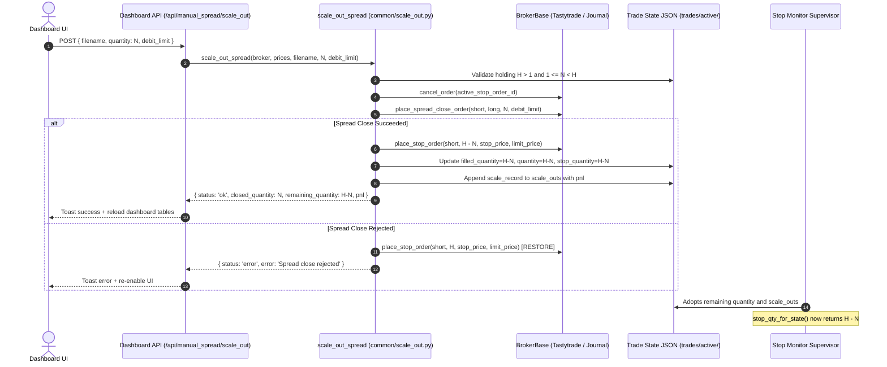

# Spread Scale-Out (Partial Close) Feature Implementation

**Date:** 2026-10-01  
**Category:** Feature Enhancement / Order Execution Safeguard  
**Affected Components:**  
- `common/scale_out.py` (New core module)
- `dashboard/templates/index.html` (Modal `#modal-scale-out`, header button, Action column button, scaled Qty badges)
- `dashboard/manual_spread_handlers.py` (Route `/api/manual_spread/scale_out`, row metadata)
- `dashboard/server.py` (Route `/api/scale_out`, `_trade_pnl` scale_outs accumulation, slot dict)
- `blocks/stop/fill_sync.py` (`stop_is_current` exact equality check)
- `blocks/stop/monitor.py` (Stop resizing condition, disk merge policy for scale_outs)
- `blocks/stop/v3/trade_slot.py` (Disk merge policy for scale_outs, initial_quantity, stop_quantity)
- `tests/test_scale_out.py` (Unit tests)  
**Status:** Completed & Verified

---

## 1. Requirement & User Intent

The user requested a **Scale Out** feature on the dashboard to allow closing a partial quantity of active vertical spread contracts instead of exiting all at once:
1. Prompts for how many contracts to close, validating $1 \le \text{qty} < \text{current holding}$.
2. Cancels the active broker stop order on the short leg.
3. Sends a spread close order for the chosen quantity (`scale_qty`).
4. Immediately places a replacement stop order for the remaining contracts (`holding - scale_qty`) at the same stop price.
5. Ensures software breach checks and exchange stops monitor only the remaining contracts and never touch or double-close scaled-out contracts.
6. Realized P&L from scaled-out contracts is accumulated alongside the live/closed P&L of the remaining position.

---

## 2. Technical Architecture & State Machine



---

## 3. Detailed Implementation Breakdown

### 3.1 Core Scale-Out Engine (`common/scale_out.py`)
- **Validation**: Rejects scale-out if `holding <= 1` or if `close_qty < 1` or `close_qty >= holding`.
- **Quote Resolution**: Resolves limit debit using `resolve_spread_close_debit()` with `_PricesFeedWrapper` fallback to protect against raw MQTT dictionary inputs.
- **Fail-Safe Stop Restoration**: If the spread close order is rejected by the broker, the stop for the original holding $H$ is immediately restored.
- **Replacement Stop**: Once spread close succeeds, an exchange stop (or OCO if applicable) is placed for $H - N$ contracts with full stop history auditing.
- **State Recording**: Tracks `initial_quantity`, updates `filled_quantity` and `quantity` to $H - N$, and records:
  ```json
  {
    "quantity": 1,
    "order_id": "510999001",
    "debit_limit": 1.40,
    "close_price": 1.40,
    "pnl": 60.0,
    "status": "filled",
    "timestamp": "2026-10-01T11:40:00"
  }
  ```

### 3.2 Stop Monitor Safety (`blocks/stop/`)
- In `blocks/stop/fill_sync.py`:
  - `stop_is_current`: Changed check from `>= stop_qty_for_state` to `== stop_qty_for_state`. If `stop_quantity > filled_quantity`, the supervisor flags the stop as mismatched.
- In `blocks/stop/monitor.py`:
  - Line 447: Resizing condition changed from `< filled` to `!= filled` so downward resizing triggers automatically if an out-of-sync stop is encountered.
  - `_maybe_merge_disk_stop_state`: Adopts `scale_outs` and `initial_quantity` from disk.
- In `blocks/stop/v3/trade_slot.py`:
  - `merge_policy`: Added `'scale_outs'`, `'initial_quantity'`, and `'stop_quantity'` to disk merge keys.

### 3.3 Dashboard P&L Integration (`dashboard/server.py`)
- In `_trade_pnl`:
  - Accumulates realized P&L across all items in `trade.get('scale_outs')`:
    $$\text{scaled\_pnl} = \sum s[\text{'pnl'}]$$
  - Added to live P&L on the remaining position:
    $$\text{pnl} = (\text{net\_credit} - \text{cur\_spread}) \times 100 \times \text{remaining\_qty} + \text{scaled\_pnl}$$
  - Added to closed P&L:
    $$\text{pnl} = (\text{net\_credit} - \text{exit\_credit}) \times 100 \times \text{remaining\_qty} + \text{scaled\_pnl}$$

### 3.4 Frontend UI (`dashboard/templates/index.html`)
- **Header Button**: "Scale Out" button in Active Manual Spreads card header (`msScaleOutSelected()`).
- **Row Action**: "Scale" button in Action column rendered whenever `r.filled > 1` and trade is open/closing (`openScaleOutModal(fn)`).
- **Quantity Badge**: If `scaled_qty > 0`, the Qty column displays a badge (e.g. `2 -1` indicating 2 open, 1 scaled out).
- **Interactive Modal (`#modal-scale-out`)**:
  - Displays lot, leg, entry credit, live spread, and active stop.
  - Interactive contracts input with real-time feedback: `${closeQty} to close | ${remaining} remaining`.
  - Disables submit if `qty >= holding` or `qty < 1` with helpful guidance.
  - Clear 4-step sequence callout confirming old stop cancel, close placement, new stop placement, and software stop safety.

---

## 4. Automated Verification & Test Results

Created dedicated unit test suite in `tests/test_scale_out.py`:
- `test_validation_holding_one`: Verifies rejection when holding is 1 contract.
- `test_validation_quantity_bounds`: Verifies rejection when `qty >= holding` or `qty <= 0`.
- `test_successful_scale_out`: Verifies complete 4-step lifecycle (stop cancel, close order, stop replacement, state update).
- `test_pnl_with_scaled_portions`: Verifies both live and final closed P&L include scaled-out amounts.
- `test_spread_close_failure_restores_stop`: Verifies original stop restoration if spread close is rejected.

### Test Execution Output
```
tests/test_scale_out.py::TestScaleOut::test_pnl_with_scaled_portions PASSED
tests/test_scale_out.py::TestScaleOut::test_spread_close_failure_restores_stop PASSED
tests/test_scale_out.py::TestScaleOut::test_successful_scale_out PASSED
tests/test_scale_out.py::TestScaleOut::test_validation_holding_one PASSED
tests/test_scale_out.py::TestScaleOut::test_validation_quantity_bounds PASSED
============================== 5 passed in 3.12s ==============================
```
Regression suites verified:
- `tests/test_trade_pnl_qty.py`: PASSED
- `tests/test_build_manual_trades.py`: PASSED
- `tests/test_fill_sync.py`: PASSED
- `tests/test_v3_manual_kill.py`: PASSED
