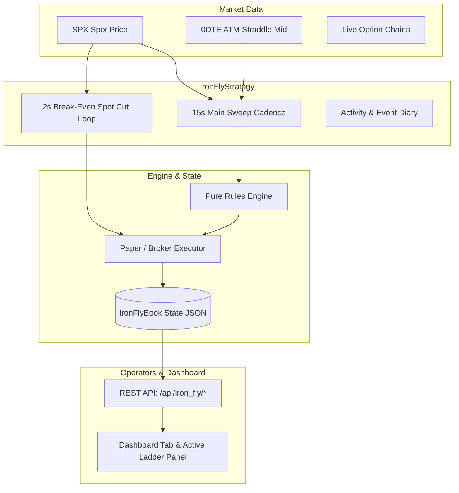

# Dale Perryman NFH SPX 0DTE Iron Fly Strategy Implementation

**Date:** 2026-10-03  
**Status:** Implemented & Verified  
**Category:** New Strategy Integration  
**Affected Components:**
- Pure Rule Engine: `strategies/iron_fly/rules.py`
- Order Builders & Normalization: `strategies/iron_fly/orders.py`
- Lifecycle Book & Persistence: `strategies/iron_fly/book.py`
- Execution Loops & Chasers: `strategies/iron_fly/executor.py`
- Strategy Runner & Cadence: `strategies/iron_fly/strategy.py`
- Stop Profile: `blocks/stop/profiles/iron_fly.py`, `blocks/stop/profiles/__init__.py`
- Trades Layout & Standalone Runner: `common/trades_layout.py`, `common/standalone_runner.py`
- Strategy Config: `config/strategies.yaml`
- Dashboard API & UI: `dashboard/db.py`, `dashboard/server.py`, `dashboard/templates/index.html`
- Automated Tests: `tests/test_iron_fly_*.py`

---

## 1. Overview & Strategy Rules

This implementation realizes Dale Perryman's "NFH" (No Free Lunch / Non-directional Iron Fly) SPX 0DTE ladder strategy as an autonomous, modular strategy conforming to the architecture of MEIC, Skyline, Perma Bull PCS, and Mean Reversion.

### Key Rules Implemented (Updated to Theta Fly Trap NFH v28/v29 Specification):
1. **Underlying & Expiration:** SPX / SPXW 0DTE options exclusively.
2. **Initial Position Entry:**
   - Opens at **10:35 AM Eastern** (configurable, default 10:35 AM ET).
   - Opens an **ATM, $50 wide Iron Butterfly (IB)** in SPX ($cw=50, pw=50$).
   - Validates initial combo mid credit is between Min Mid Price ($3.00) and Max Mid Price ($50.00).
3. **Subsequent Fly Add Evaluation (Closest Open IB):**
   - Evaluates the **open IB closest to current SPX spot price**: $itm = |Spot - Center_{closest}|$.
   - Evaluates that closest IB's **opening price / premium collected**:
     - **Credit > $20.00**: Triggered when $itm > \$15.00$ $\rightarrow$ add new IB centered **±$20** away ($5 above/below underlying).
     - **Credit $15.00–$20.00**: Triggered when $itm > \$10.00$ $\rightarrow$ add new IB centered **±$15** away ($5 above/below underlying).
     - **Credit < $15.00**: Triggered when $itm > \$7.50$ $\rightarrow$ add new IB centered **±$10** away ($5 above/below underlying).
     - **Tight Mode (after 2:00 PM ET)**: If 50-wide mid < $10 (or time >= 3:30 PM), tolerance tightens to **$2.50** $\rightarrow$ add new IB centered **±$5** away.
4. **Wing Selection for Subsequent Adds:**
   - Targets **$0.40 mid** for the long put wing, bounded between **Min Wing Width $20** and **Max Wing Width $50**.
   - Symmetrically matches call wing width ($cw = pw$) unless clash requires adjustment.
5. **Strike Clash Prevention:**
   - Never `BUY_TO_OPEN` a long wing at a strike where the active book is already `SELL_TO_OPEN` short.
   - Never center a new fly at a strike where the active book is already `BUY_TO_OPEN` long.
6. **Beyond Breakeven Stop Loss:**
   - Cut occurs when spot moves **beyond** the breakeven points:
     $$Spot \le (BE_{low} - BBE) \quad \text{or} \quad Spot \ge (BE_{high} + BBE)$$
   - Default Beyond Breakeven Close Amount ($BBE$): **$0.01**.
   - Supports PABBE (High $2.00, Mid $1.00, Low $0.01), Late BBE (3:30 PM $1.50), and EOD BBE (3:50 PM $2.50).
   - Min Close RoR Guard: if return on risk $< -90\%$, position cut is suppressed (avoiding slippage/fees near max loss).
7. **Circuit Breakers & Day Targets:**
   - Rapid price moves: halts adds and flattens open positions if spot moves $\ge \$25$ in 1 min or $\ge \$40$ in 2 mins.
   - Max VIX change: halts adds and flattens if VIX increases by $\ge 15$ points from market open.
   - Day PT Close (+$1,000) and Day Max Loss Close (-$2,000).
8. **Cash Settlement:**
   - Flies surviving through 4:00 PM ET cash-settle against the official cash index settlement.

---

## 2. Architecture & Data Flow



---

## 3. Implementation Details

- **`strategies/iron_fly/rules.py`**: Functional module without network or broker side-effects for testability.
- **`strategies/iron_fly/orders.py`**: Constructs 4-leg Net Credit combos for entry and 4-leg Net Debit combos for exit, rounding combo credits down and debits up to the nearest 0.05 tick.
- **`strategies/iron_fly/book.py`**: Tracks multi-fly state, open risk, realized/unrealized P&L, fee tracking ($1.30/leg/contract), and writes atomic state JSON. Compatible with `common/manual_close.py` via both `flies` dict and `structures` list schemas.
- **`strategies/iron_fly/executor.py`**: Contains `PaperExecutor` for simulated paper trading and `BrokerExecutor` implementing MEIC cancel-and-re-quote loops (5s pause, cancel, step down credit -0.05 down to limit floor, max 6 attempts / 45s).
- **`strategies/iron_fly/strategy.py`**: Core strategy orchestrator with background threads, auto-subscription to live streamer symbols, risk cap enforcement ($15,000 max open risk, $2,500 daily loss stop, 20 max flies/day), and live approval modes.
- **`dashboard/server.py` & `dashboard/templates/index.html`**:
  - Live top P&L stat card for Iron Fly.
  - Dedicated Iron Fly panel with day status, 83% ratio monitor, pending approval controls, active ladder table with live distance-to-BE, closed history, and activity diary.

---

## 4. Automated Verification

All 33 unit tests pass cleanly:
```bash
.venv\Scripts\python.exe -m pytest tests/test_iron_fly_rules.py tests/test_iron_fly_orders.py tests/test_iron_fly_book.py tests/test_iron_fly_strategy.py tests/test_iron_fly_dashboard.py tests/test_strategy_loader.py
```
Output:
```
============================= 33 passed in 5.03s ==============================
```
