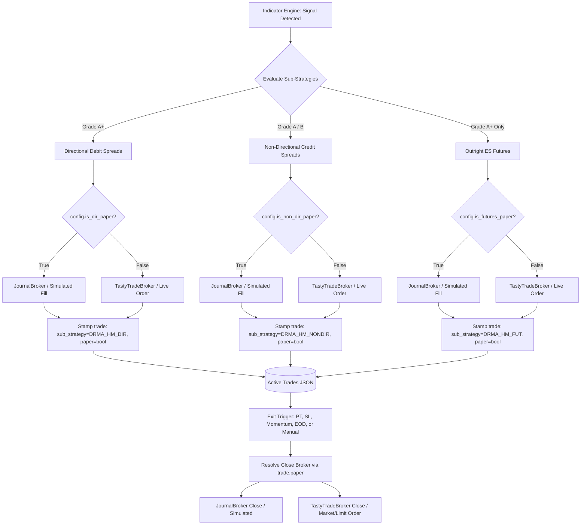

# DRMA+H-M: Independent Sub-Strategy Paper / Live Execution

**Date:** 2026-10-19  
**Category:** Architectural Feature / Strategy Multi-Broker Execution  
**Affected Components:**  
- `strategies/drma_hm/config.py`
- `strategies/drma_hm/strategy.py`
- `common/broker_factory.py`
- `common/standalone_runner.py`
- `common/manual_close.py`
- `dashboard/server.py`
- `config/strategies.yaml`
- `dashboard/templates/index.html`
- `tests/test_drma_hm.py`
- `tests/test_drma_hm_dashboard.py`  
**Status:** Complete & Verified  

---

## 1. Problem Statement & Root Cause

The Daily Reset Moving Average + Hilega-Milega strategy (`DRMA_HM_SPX`) coordinates three decoupled sub-strategies:
1. **Directional Options (`DRMA_HM_DIR`):** 0DTE SPX Bull Call / Bear Put Debit Spreads triggered on high-conviction momentum expansions.
2. **Non-Directional Options (`DRMA_HM_NONDIR`):** 0DTE SPX Bull Put / Bear Call Credit Spreads (or midday Iron Condors) harvesting theta premium.
3. **Directional Futures (`DRMA_HM_FUT`):** Outright `/ES` futures scalp trades with a strict 5.0 pt profit target and 5.0 pt stop loss on Grade A+ signals.

Previously, the Live vs. Paper setting was strictly global at the `DRMA_HM_SPX` strategy level (`paper: true` or `paper: false`). This created several operational limitations:
- Operators could not trade outright ES Futures live while running experimental Options spreads on paper.
- Operators could not paper-test aggressive directional debit spreads while simultaneously harvesting live theta premium on conservative credit spreads.
- `StandaloneStrategyRunner` enforced a rigid `_assert_paper_safety` check: if `config.paper == True` but the runner held a live broker reference, the entire runner would halt on a critical safety exception.

---

## 2. Technical Architecture & Design

### Sub-Strategy Broker Routing & Execution Model



### Key Architectural Principles
1. **Hierarchical Inheritance with Tri-State Overrides:**
   - Sub-strategy fields (`dir_paper`, `non_dir_paper`, `futures_paper`) are `Optional[bool]` defaulting to `None`.
   - When `None`, sub-strategies inherit `self.paper` (backward-compatible global control).
   - Setting `False` runs that specific sub-strategy **LIVE**; setting `True` runs it **PAPER**.
2. **Dual Cached Multi-Broker Resolution:**
   - `DRMAHMStrategy._get_broker(is_paper)` dynamically returns the paper `JournalBroker` or live `TastyTradeBroker` via `get_shared_broker_for_strategy(self.config.name, paper=is_paper)`.
   - Entries and exits use the resolved broker corresponding to the trade's paper mode.
3. **Independent Trade Lifecycle Tracking:**
   - Every active trade JSON records `sub_strategy` (`DRMA_HM_DIR`, `DRMA_HM_NONDIR`, or `DRMA_HM_FUT`) and `paper` (`true` or `false`).
   - Manual close actions in `common/manual_close.py` inspect `trade.get('paper')` to route orders to the correct broker.
4. **Runner Safety Coordination:**
   - `DRMAHMConfig.has_any_live_sub_strategy` returns `True` if any enabled sub-strategy is live.
   - `StandaloneStrategyRunner._assert_paper_safety()` bypasses the false-alarm halt when `has_any_live_sub_strategy` is True, delegating broker routing to the sub-strategy layer.

---

## 3. Detailed Implementation Breakdown

### 1. `strategies/drma_hm/config.py`
- Added configuration dataclass fields:
  - `dir_paper: Optional[bool] = None`
  - `non_dir_paper: Optional[bool] = None`
  - `futures_paper: Optional[bool] = None`
- Added helper properties:
  - `is_dir_paper -> bool`: Returns `dir_paper` if explicitly set, else parent `paper`.
  - `is_non_dir_paper -> bool`: Returns `non_dir_paper` if explicitly set, else parent `paper`.
  - `is_futures_paper -> bool`: Returns `futures_paper` if explicitly set, else parent `paper`.
  - `has_any_live_sub_strategy -> bool`: Returns `True` if any enabled sub-strategy is live.
  - `is_sub_strategy_paper(sub_strategy: str) -> bool`: Resolves paper mode for named sub-strategies (`DRMA_HM_DIR`, `DRMA_HM_NONDIR`, `DRMA_HM_FUT`, or aliases).

### 2. `strategies/drma_hm/strategy.py`
- Cached broker references `_paper_broker` and `_live_broker`.
- Implemented `_get_broker(self, is_paper: bool)` to dynamically return either paper or live broker.
- Updated `_enter_directional_trade()`:
  - Evaluates `is_paper = bool(self.config.is_dir_paper)`.
  - Obtains `order_broker = self._get_broker(is_paper)`.
  - Stamped `trade_data['sub_strategy'] = 'DRMA_HM_DIR'` and `trade_data['paper'] = is_paper`.
- Updated `_enter_non_directional_trade()` and `_enter_iron_condor()`:
  - Evaluates `is_paper = bool(self.config.is_non_dir_paper)`.
  - Obtains `order_broker = self._get_broker(is_paper)`.
  - Stamped `trade_data['sub_strategy'] = 'DRMA_HM_NONDIR'` and `trade_data['paper'] = is_paper`.
- Updated `_enter_directional_futures_trade()`:
  - Evaluates `is_paper = bool(self.config.is_futures_paper)`.
  - Obtains `order_broker = self._get_broker(is_paper)`.
  - Stamped `trade_data['sub_strategy'] = 'DRMA_HM_FUT'` and `trade_data['paper'] = is_paper`.
- Updated `_exit_trade()`:
  - Determines `is_paper = bool(trade.get('paper', self.config.paper))`.
  - Obtains `close_broker = self._get_broker(is_paper)` ensuring positions close through their origin execution environment.

### 3. `common/broker_factory.py`
- Updated `is_strategy_paper(strategy_name, default=True)`:
  - Added support for sub-strategy identifiers `DRMA_HM_DIR`, `DRMA_HM_NONDIR`, and `DRMA_HM_FUT`.
  - Checks daily overrides under parent `DRMA_HM_SPX` for `dir_paper`, `non_dir_paper`, and `futures_paper` with fallback to `paper`.
  - Checks `strategies.yaml` `config_overrides` for `dir_paper`, `non_dir_paper`, and `futures_paper`.

### 4. `common/standalone_runner.py`
- Updated `_assert_paper_safety()`:
  - If `getattr(self.config, 'has_any_live_sub_strategy', False)` is `True`, bypasses the halt check so mixed-mode strategies can safely manage their own brokers.

### 5. `common/manual_close.py`
- Updated `close_structure()`:
  - Prioritizes `trade.get('paper')` over the passed-in strategy parameter, ensuring manual closes always respect the trade's actual execution mode.

### 6. `dashboard/server.py`
- Updated `_resolve_strategy_config()`:
  - Supports `DRMA_HM_DIR`, `DRMA_HM_NONDIR`, and `DRMA_HM_FUT` aliases resolving to `DRMAHMConfig`.
- Updated `_set_strategy_control()`:
  - Recognizes `DRMA_HM_DIR`, `DRMA_HM_NONDIR`, and `DRMA_HM_FUT` targets and translates paper toggle requests into `dir_paper`, `non_dir_paper`, and `futures_paper` overrides under `DRMA_HM_SPX`.
- Updated `/api/drma_hm/today`:
  - Returns `paper`, `dir_paper`, `non_dir_paper`, and `futures_paper` in JSON response.

### 7. `config/strategies.yaml`
- Stored default configuration overrides for `DRMA_HM_SPX`:
  - `dir_paper: true`
  - `non_dir_paper: true`
  - `futures_paper: true`

### 8. `common/daily_overrides.py` & `strategies/base.py` (Hot-Reload Safeguard)
- **Problem:** Long-running services (e.g. `run.py` launcher running for hours) held cached class definitions of `DRMAHMConfig` in `sys.modules`. Submitting overrides for newly-added dataclass fields (`dir_paper`, `non_dir_paper`, `futures_paper`) raised `ValueError: unknown override keys: ['non_dir_paper']`.
- **Solution:**
  - `set_overrides()`: When unrecognized keys are detected, dynamically reloads the configuration module via `importlib.reload(mod)` and inspects the refreshed class definition. Explicitly allows `{'dir_paper', 'non_dir_paper', 'futures_paper'}` for `DRMA_HM_SPX`.
  - `apply_config_overrides()`: Applies matching dynamic module refresh logic and explicit field fallback for `DRMA_HM_SPX`.

### 9. `dashboard/templates/index.html` (Ergonomic UI Redesign)
- **Relocated Toggle Badges:**
  - Removed cluttered sub-strategy button groups from the top `#drma-hm-header-alert` banner, keeping only the global master strategy toggle.
  - Placed interactive, styled toggle buttons directly inside each of the 3 sub-strategy column headers in the **Strategy Parameters & Overrides** card:
    - `Non-Directional Spreads (Theta Credit)` -> `#drma-hm-ov-nondir-badge`
    - `Directional Spreads (Expansion Debit)` -> `#drma-hm-ov-dir-badge`
    - `Directional Futures (ES Outright · $50/pt)` -> `#drma-hm-ov-fut-badge`
- **Interactive Badges & Visual Polish:**
  - Buttons render as compact pills with micro-animations (`drma-sub-toggle-btn` class with hover scale).
  - Dynamic styling: Slate Gray (`btn-secondary`) for **PAPER**, Crimson Red (`btn-danger`) for **LIVE**, with a bidirectional swap icon (`bi-arrow-left-right`).
- **Two-Way Synchronization:**
  - Clicking any column header toggle prompts for confirmation when switching to LIVE, sends a `POST` request to `/api/strategy/DRMA_HM_SPX/overrides`, and instantly synchronizes the column's **Execution Mode** dropdown (`drma-hm-ov-*-paper`).
  - Selecting "Inherit Strategy Default" in the dropdown automatically invokes `DELETE /api/strategy/DRMA_HM_SPX/overrides/<sub_key>` to cleanly revert to the global strategy default without orphaned keys.

---

## 4. Automated Verification & Test Results

### Executed Tests
1. `tests/test_drma_hm.py`:
   - `test_independent_sub_strategy_config_inheritance_and_overrides`: Validates default fallback to parent `paper`, explicit sub-strategy overrides, and `has_any_live_sub_strategy`.
   - `test_mixed_mode_routing_futures_live_options_paper`: Verifies that with futures live and options paper, options trade enters and closes without live broker orders, while futures trade executes real orders to live broker.
   - `test_mixed_mode_routing_options_live_futures_paper`: Verifies that credit options send live multi-leg orders while futures orders remain simulated on paper.
   - `test_standalone_runner_allows_mixed_mode_without_safety_halt`: Verifies runner paper safety check does not raise exceptions in mixed mode.
2. `tests/test_drma_hm_dashboard.py`:
   - `test_sub_strategy_independent_control_and_overrides`: Verifies POST `/api/strategy/DRMA_HM_DIR/control`, POST `/api/strategy/DRMA_HM_SPX/overrides`, GET `/api/drma_hm/today`, and override deletion lifecycle.
3. Regression test suites:
   - `tests/test_broker_factory_multi_strategy.py`
   - `tests/test_standalone_runner.py`

### Test Output Summary
```
$ uv run pytest tests/test_drma_hm.py tests/test_drma_hm_dashboard.py
============================= test session starts =============================
platform win32 -- Python 3.13.5, pytest-9.1.1, pluggy-1.6.0
rootdir: C:\Users\User\OneDrive\Desktop\Projects\2026\MEIC-with-Dash-main-V2
configfile: pyproject.toml
plugins: anyio-4.14.0
collected 35 items

tests\test_drma_hm.py ...............................                    [ 88%]
tests\test_drma_hm_dashboard.py ....                                     [100%]

============================= 35 passed in 9.71s ==============================
```
