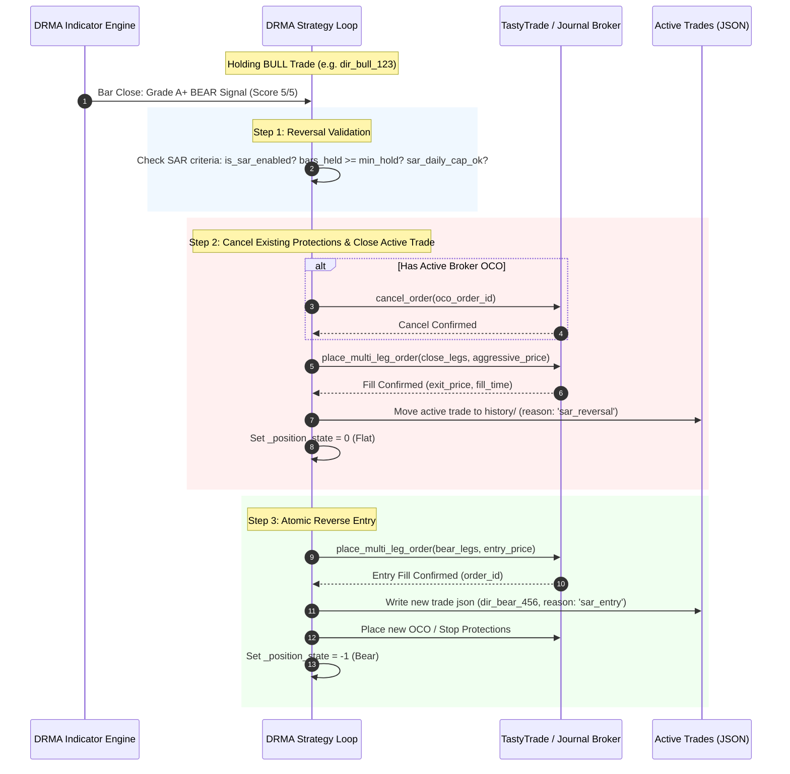

# DRMA+H-M: Stop and Reverse (SAR) Architecture & Directional Flip Design

**Date:** 2026-10-22  
**Category:** Strategy Execution / Risk Management / Position Lifecycle  
**Affected Strategy:** `DRMA_HM_SPX` (`DRMA_HM_DIR`, `DRMA_HM_NONDIR`, `DRMA_HM_FUT`)  
**Status:** Architectural Design & Discussion (No Code Changes Pending Alignment)  

---

## 1. Executive Summary & Objective

In intraday trend-following and momentum strategies like **DRMA+H-M**, market conditions can shift decisively within a single session. When holding a trade aligned with an earlier directional bias (e.g., a **BULL** Call Debit Spread or Bull Put Spread) and the market rolls over into a confirmed **BEAR** expansion (Grade A or A+ breakdown), the strategy faces a structural decision:

1. **Current Behavior:** Continue managing the active trade until its predetermined profit target, fixed stop loss, or momentum trail triggers. The opposite signal is ignored or rejected because position state is non-zero (`_position_state != 0`).
2. **Proposed Concept (Stop and Reverse / SAR):** Immediately close the active trade on the invalidated side and seamlessly transition into an open trade in the newly signaled direction.

This document formalizes the operational mechanics, broker execution safeguards, failure modes (such as midday chop whipsaws), and design options for implementing Stop and Reverse in DRMA.

---

## 2. Current State vs. Stop and Reverse

| Lifecycle Event | Current DRMA Implementation | Proposed Stop and Reverse (SAR) |
| :--- | :--- | :--- |
| **Opposite Signal Arrives** | Ignored for entries because `_dir_options_position_state != 0` or `_credit_options_position_state != 0`. | Evaluated as a potential reversal trigger. |
| **Existing Trade Exit** | Waits for profit target, stop loss, broker OCO fill, 2-bar 21 EMA breach, or 14:50 CT EOD close. | Active trade is immediately commanded to close at market/aggressive limit to prevent further adverse excursion. |
| **New Opposite Entry** | Only possible on a later bar after the previous trade has completely exited and cooldown has elapsed. | Queued immediately upon verified fill confirmation of the closing trade. |
| **Capital & Margin** | Cleanly serial; capital is never contested between opposite positions. | Requires strict sequential fill synchronization so broker buying power is released before committing capital to the reverse spread. |

---

## 3. High-Priority Risks & Failure Modes

### 3.1 The Midday EMA "Whipsaw / Chop Grind" Trap
The greatest danger of automated reversal is range-bound consolidation around the 21 EMA:
- During low-volatility midday hours (10:30–12:30 CT), price frequently crosses above and below the 21 EMA without genuine follow-through.
- A naïve reversal rule can trigger a destructive feedback loop:
  1. Long Bull at top of range $\rightarrow$ market ticks down below EMA.
  2. Close Bull at a loss, Open Bear at the bottom of the range $\rightarrow$ market bounces.
  3. Close Bear at a loss, Open Bull near the top.
- **Mitigation:**
  - **Asymmetric Confirmation:** Require a higher bar for reversals than for initial morning entries (e.g., initial entry allowed on Grade A (4/5), but reversal strictly requires **Grade A+ (5/5)**).
  - **Minimum Holding Period:** Enforce `sar_min_hold_bars >= 3` (15 minutes) before a trade can be reversed, avoiding single-bar false-break flushes.
  - **Daily Reversal Cap:** Limit reversals to a maximum of **1 reversal per day** (`sar_max_daily_flips = 1`) to preserve capital when the market is indecisive.

### 3.2 Margin & Broker Order Collisions
In live trading with brokers like Tastytrade or Schwab, options debit and credit spreads consume buying power:
- If the strategy attempts to submit the new opposite spread before the closing order of the previous spread is fully executed, the broker will reject the new order for `INSUFFICIENT_BUYING_POWER`.
- Therefore, **the system cannot fire exit and entry orders simultaneously**. It must use an atomic sequential pipeline.

### 3.3 Active Broker OCO Orders
For Non-Directional credit spreads, a live broker-side OCO order protects profit target and stop loss.
- Before submitting any manual close for reversal, the active OCO order **must be explicitly cancelled** and confirmed cancelled; otherwise, the OCO trigger could execute simultaneously with the close order, creating an unintended short position.

---

## 4. Architectural State Machine & Execution Flow



---

## 5. Architectural Options for Implementation

### Approach 1: Decoupled via Exit Style (Recommended First Step)
- **Concept:** Rather than building a complex simultaneous close-and-open engine, use the existing [evaluate_exit_signal](file:///c:/Users/User/OneDrive/Desktop/Projects/2026/MEIC-with-Dash-main-V2/strategies/drma_hm/indicators.py#L322-L375) to exit aggressively on opposite momentum (e.g., using `exit_style: 'confirmed_hm'`).
- **Mechanism:** When the 21 EMA is breached and HM crosses over/under, the trade exits cleanly. On the very next 5-minute bar, if the opposite setup is valid, the strategy enters naturally.
- **Pros:**
  - Zero broker race conditions.
  - Zero risk of buying-power rejection.
  - Code is already verified and operating safely today.
- **Cons:**
  - 1-bar delay (5 minutes) before the reverse trade is entered.

### Approach 2: Explicit Synchronous SAR Engine
- **Concept:** A dedicated `_execute_stop_and_reverse()` pipeline that intercepts opposite signals on the active bar, cancels working orders, waits for fill confirmation, and enters the reverse trade within the same evaluation cycle.
- **Mechanism:**
  1. Transition strategy status to `REVERSING`.
  2. Cancel working OCO.
  3. Close active spread with market/marketable limit order.
  4. Poll broker with a 10-second timeout for fill confirmation.
  5. Upon fill, immediately call `_enter_directional_trade()` or `_enter_non_directional_trade()`.
  6. If close order fails or times out, abort the new entry and raise an alert to prevent unmanaged exposure.
- **Pros:**
  - Captures the exact entry bar on fast momentum breakdowns.
- **Cons:**
  - Requires handling broker timeout edge cases, network retries, and partial fills mid-transition.

### Approach 3: Instrument-Specific Rules
Not all instruments behave identically under reversal:
- **Outright ES Futures (`DRMA_HM_FUT`):** Futures can reverse atomically with a single broker order (e.g., if Long 1 `/ES`, sending a `SELL 2` order closes the long and opens the short simultaneously in one fill with zero margin gap).
- **Options Spreads (`DRMA_HM_DIR` & `DRMA_HM_NONDIR`):** Cannot be flipped in a single order because options debit and credit spreads use different strike combinations and leg structures. They must be executed as two distinct 2-leg or 4-leg combos.

---

## 6. Proposed Configuration Schema

If enabled in a future release, the following configuration parameters would govern SAR behavior in [strategies/drma_hm/config.py](file:///c:/Users/User/OneDrive/Desktop/Projects/2026/MEIC-with-Dash-main-V2/strategies/drma_hm/config.py):

```python
# --- Stop and Reverse (SAR) Configuration ---
enable_stop_and_reverse: bool = False      # Master toggle for opposite-side close and reverse
sar_min_grade: str = 'Grade A+ Only'       # Minimum grade required to trigger a reversal (Grade A+ Only vs Grade A and A+)
sar_min_hold_bars: int = 3                 # Minimum bars held before trade is eligible for SAR (filters initial noise)
sar_max_daily_reversals: int = 1           # Max allowed reversals per day (prevents chop grind)
sar_allow_cross_vehicle: bool = False      # Allow Directional to close Non-Directional and vice versa
sar_close_timeout_sec: float = 10.0        # Seconds to wait for close fill before aborting reverse entry
```

---

## 7. Open Design Decisions for User Alignment

Before writing any trading logic or executing code changes, the following strategic preferences should be decided:

1. **Sub-Strategy Scope:**
   - Should SAR apply strictly within the same instrument (e.g. Directional Bull Call flips to Directional Bear Put), or should a Grade A+ signal also close an active Non-Directional trade?
2. **Setup Grade Threshold:**
   - Should reversals only be permitted on **Grade A+ (Score 5/5)** to filter out choppy reversals, or also on Grade A (Score 4/5)?
3. **Execution Mode Policy:**
   - If one sub-strategy is Paper and another is Live, should a Paper signal close a Live trade (recommended: **strictly NO**, paper must never affect live capital)?
4. **Preferred Path:**
   - Do you prefer **Approach 1** (tightening exit momentum so it exits immediately, then enters on the next bar) or **Approach 2** (building the dedicated immediate close-and-flip state machine)?
