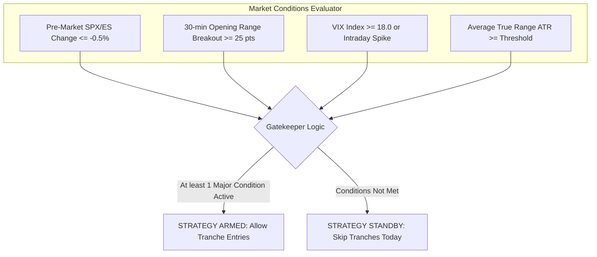
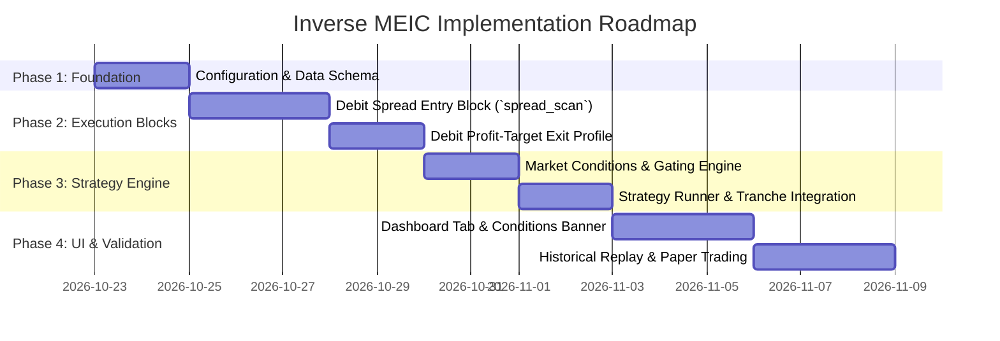

# Inverse MEIC (Long Volatility) Strategy — Architectural Design & Roadmap

**Date:** 2026-10-22  
**Category:** New Strategy Design / Volatility Hedge / 0DTE SPX  
**Strategy Name:** `INVERSE_MEIC_SPX` (Reverse Iron Condor / Twin Debit Spreads)  
**Status:** Implemented in Production (Strategies, Stop Engine, Dashboard & Tests Active)  

---

## 1. Executive Summary & Problem Formulation

Standard **MEIC** is a short volatility, positive theta strategy that sells 0DTE SPX Iron Condors (Put Credit Spread + Call Credit Spread) across up to 6 daily tranches.
- **Normal Days:** SPX trades in a bounded range; both wings expire worthless or hit profit targets; premium is collected.
- **Volatile / Trend Days (e.g., 2026-10-22):** The market makes violent directional expansions and intraday whipsaws. In the 10-30, 11-00, and 01-00 tranches today, **both wings suffered 2× stopouts** sequentially (e.g. Put stopped on a drop, then Call stopped on the subsequent rally).

**The Proposed Solution — Inverse MEIC:**
A dedicated **long volatility / long gamma** companion strategy designed to turn volatile, high-ATR sessions into profitable opportunities by buying cheap defined-risk vertical spreads on both wings simultaneously.

---

## 2. Locked-In Design Decisions (User Aligned)

| Decision Item | Chosen Approach | Rationale & Mechanics |
| :--- | :--- | :--- |
| **Relationship to MEIC** | **Standalone Companion (No Dynamic Pairing)** | Running as an independent strategy keeps the code modular, prevents race conditions, and eliminates complex state-machine coupling. |
| **Position Sizing & Target Mode** | **1 Contract & Single Profit Target** | Initial testing is with 1 contract per side. Since 1 contract cannot be fractionally scaled out, exit is executed 100% at a single target multiple. |
| **Loss Management** | **"Let it Bleed" (No Stop Loss)** | Defined risk is strictly capped at entry debit paid (~$0.80 – $1.00 = $80 – $100 per side). No stop loss prevents getting chopped out early and preserves the ability for whipsaw days to produce **two winning sides**. |
| **Market Gating / Filter** | **Pre-market Drop $\ge 0.5\%$ + Intraday Volatility** | Monitored before entry. Only fires when market conditions indicate an expansion regime. |
| **Dashboard UI** | **Conditions Monitor Banner at Top of Tab** | Real-time status cards showing every market condition tracked (e.g., Pre-Market % Change, 30m ORB Range, VIX level, Strategy Armed/Standby). |

---

## 3. Payoff Mathematics: The 2× to 4× Exit

Because **both sides** (Call Debit Spread and Put Debit Spread) are entered simultaneously, the winning leg must generate enough profit to:
1. Cover its own cost.
2. Fully absorb the 100% loss of the opposite losing leg.
3. Yield an attractive net return on total committed capital.

### Mathematical Model (Assuming $1.00 Debit Paid per Side):
- **Call Debit Spread (CDS):** Cost $1.00 ($100 risk)
- **Put Debit Spread (PDS):** Cost $1.00 ($100 risk)
- **Total Tranche Capital at Risk ($D_{total}$):** **$2.00 ($200)**

$$ \text{Net P&L} = \text{Exit Credit}_{\text{Winner}} - D_{total} $$

| Exit Multiple | Winning Spread Mark | Gross Proceeds | Total Tranche Cost | Net P&L | Tranche ROI | Assessment |
| :---: | :---: | :---: | :---: | :---: | :---: | :--- |
| **1.5×** | $1.50 | $1.50 | $2.00 | **-$0.50 (-$50)** | -25% | **Unacceptable** (Fails to cover both sides) |
| **2.0×** | $2.00 | $2.00 | $2.00 | **$0.00** | 0% | **Exact Breakeven** (Winner pays for loser) |
| **2.5×** | $2.50 | $2.50 | $2.00 | **+$0.50 (+$50)** | +25% | Covers both sides + modest profit |
| **3.0×** | $3.00 | $3.00 | $2.00 | **+$1.00 (+$100)** | **+50%** | **Recommended Base Target** (Healthy profit) |
| **4.0×** | $4.00 | $4.00 | $2.00 | **+$2.00 (+$200)** | **+100%** | **Target for High Volatility / CPI / FOMC** |

### The Whipsaw Sequential Double-Winner
On extreme whipsaw days (such as today 2026-10-22):
- **10:29 CT Entry:** PDS entered at $0.90, CDS entered at $0.75 (Total cost: $1.65).
- **10:31 CT Down-flush:** SPX plunges; PDS mark surges to $2.70 (3.0×). PDS exits at limit target (+ $270).
- **10:55 CT Rally:** CDS was left to bleed. SPX aggressively rallies 25 points; CDS mark surges to $2.25 (3.0×). CDS exits at limit target (+ $225).
- **Combined Outcome:** Gross $495 - Cost $165 = **+$330 Net Profit (+200% ROI on the tranche)**!

---

## 4. Market Conditions & Gating Architecture

Inverse MEIC should not run on quiet, low-ATR consolidation days where both sides would slowly decay to zero. The strategy will monitor four distinct market indicators:



### Monitored Conditions:
1. **Pre-Market Move:** Index or overnight ES futures down $\ge 0.5\%$ from prior close.
2. **30-Minute ORB Range:** High minus Low of the 08:30–09:00 CT window exceeds the historical 20-day median (e.g. $\ge 25$ SPX points).
3. **VIX Level:** Spot VIX $\ge 18.0$, or VIX up $\ge 5\%$ on the day.
4. **Intraday Trend Velocity:** 5-minute candle momentum showing directional expansion away from the 21 EMA.

---

## 5. Dashboard UI: Top Conditions Monitor Banner

On the **Inverse MEIC** dashboard tab, a dedicated monitoring card will sit at the very top, giving immediate visibility into why the bot is armed or in standby:

```
+-------------------------------------------------------------------------------------------------------+
| INVERSE MEIC — MARKET REGIME MONITOR                                             [ STATUS: ARMED ]   |
+-------------------------------------------------------------------------------------------------------+
| [✓] Pre-Market Gap: -0.68% (Target: <= -0.50%)                                                        |
| [✓] 30m ORB Range: 31.5 pts (Threshold: >= 25.0 pts)                                                  |
| [ ] Spot VIX: 17.20 (Threshold: >= 18.00)                                                             |
| [✓] Realized ATR (14): 28.4 pts (Elevated)                                                            |
|                                                                                                       |
| Today's Mode: ACTIVE TRADING | Next Tranche: 11-00 CT | Target Profit Multiplier: 3.0x                |
+-------------------------------------------------------------------------------------------------------+
```

Below the banner, the standard 12-slot tranche grid will display active and pending debit spreads (CDS and PDS) with live marks, mark-to-market P&L, and target exit levels.

---

## 6. Execution & Position Lifecycle

### 6.1 Order Structure
- **Vehicle:** Vertical Debit Spreads (25 points wide).
- **Leg Actions:**
  - **CDS:** Buy OTM Call (lower strike) + Sell further OTM Call (higher strike).
  - **PDS:** Buy OTM Put (higher strike) + Sell further OTM Put (lower strike).
- **Target Entry Debit:** $0.80 to $1.10 per spread.
- **Order Placement:** Submit as `NET_DEBIT` multi-leg limit order.

### 6.2 Exit Supervision (`stop_monitor`)
1. **Profit Target Phase (`PhaseProfitTarget`):**
   - Continuously computes `debit_mark = long_mid - short_mid`.
   - When `debit_mark >= entry_debit * target_multiplier` (e.g. 3.0×):
   - Immediately fires a closing order (`SELL_TO_CLOSE` long, `BUY_TO_CLOSE` short) via limit chase to lock in profit.
2. **Loss Handling:**
   - No stop-loss order placed.
   - Position remains open through any mid-session adverse movement.
3. **EOD Settlement / Square-Off:**
   - At **14:50 CT** (10 minutes before cash close), any remaining open legs with residual value (e.g. $> \$0.10$) are closed at market. Worthless legs ($\le \$0.05$) are allowed to expire cash-settled to avoid paying closing fees.

---

## 7. Step-by-Step Development Roadmap



### Phase 1: Configuration & Data Schema
- Add `INVERSE_MEIC_SPX` configuration in `strategies/inverse_meic/config.py`.
- Define parameters: `target_debit`, `max_debit`, `spread_width`, `profit_target_multiple` (default: `3.0`), `premarket_drop_threshold` (default: `-0.005`).
- Ensure trade JSON schema supports `spread_type: 'debit'` and `profit_target_multiple`.

### Phase 2: Entry & Exit Blocks
- **Entry Block (`blocks/entry/debit_spread.py`):**
  - Implement strike search for target debit (matching `MANUAL_DEBIT_SPREAD.md` specification).
  - Connect to broker API using `place_debit_spread_order()`.
- **Stop Profile (`blocks/stop/profiles/inverse_meic.py`):**
  - Configure `StopProfile` with `PhaseProfitTarget(target_multiple=3.0)`.
  - Disable Phase 1 initial short stop, Phase 2 net credit upgrade, and Phase 3 proximity stops.

### Phase 3: Market Conditions & Strategy Runner
- Create `strategies/inverse_meic/conditions.py` to evaluate:
  - Pre-market gap from previous day close.
  - 30-minute ORB range.
  - VIX level.
- Build `InverseMEICStrategy` inheriting from `BaseStrategy`.

### Phase 4: Dashboard & Paper Validation
- Add **Inverse MEIC** tab to `dashboard/server.py` and template HTML.
- Build the real-time **Conditions Monitor Banner** at the top of the tab.
- Run in `--paper` mode alongside MEIC to benchmark performance on volatile vs quiet sessions.
