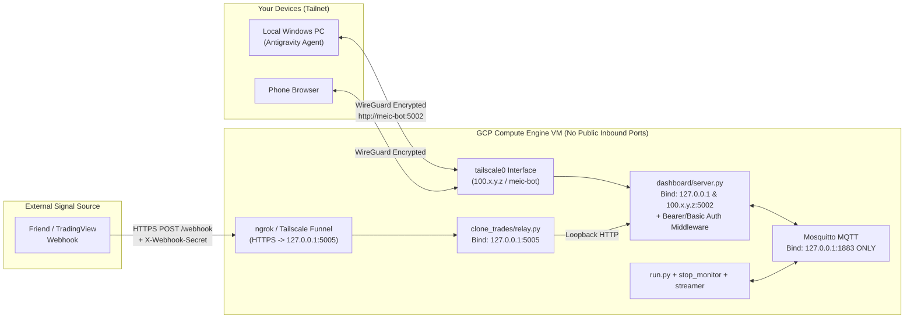

# GCP Cloud Readiness, Security Hardening & 24/6 Operational Architecture

**Date:** 2026-11-07  
**Category:** Cloud Architecture / Security / Operational Hardening / AI-Ops Workflow  
**Affected Components:** `run.py`, `dashboard/server.py`, `dashboard/process_manager.py`, `clone_trades/relay.py`, `streaming/publish_tastytrade.py`, `common/broker_factory.py`, `common/standalone_runner.py`, `strategies/drma_hm/strategy.py`, `common/logging_config.py`  
**Status:** Design Specification & Audit Report  

---

## Executive Summary

Moving `MEIC-with-Dash-main-V2` from a local Windows desktop to a Google Cloud Platform (GCP) Linux VM running **24/6** (Sunday 4:30 PM CST $\to$ Friday 3:30 PM CST) requires closing critical network security gaps, fixing two Sunday/Friday scheduling blind spots in the current launcher loop, hardening TastyTrade DXLink & OAuth session lifecycles, and adapting the logging/deployment pipeline so local AI agents can inspect production runs and ship fixes safely without disrupting open orders.

### Top 5 Critical Findings from Codebase Audit
1. **Unauthenticated Dashboard Bound to `0.0.0.0:5002`**: `dashboard/server.py` line 3648 binds to `0.0.0.0` with **zero authentication**, `cors_allowed_origins='*'`, and a hardcoded `SECRET_KEY`. Anyone who discovers the IP can fire `/api/killswitch`, place live manual spreads (`/api/manual_spread/place`), flip strategies from Paper to Live (`/api/strategy/<name>/overrides`), or read logs containing secrets.
2. **Sunday 4:30 PM CST Launch Blind Spot (`run.py` line 1013)**: If you launch the bot on Sunday at 4:30 PM CST for the 5:00 PM CST CME Globex futures open, `now.weekday() >= 5` evaluates to `True` (`Sunday == 6`) and **unconditionally puts the entire bot to sleep until Monday 8:20 AM CST**—completely missing Sunday night futures trading.
3. **Why TastyTrade Token Expired Yesterday (And What 8:20 AM Reset Missed)**:
   - TastyTrade has **three** distinct token/session layers: (a) REST Access Token (`15 min` lifetime, auto-refreshed on REST calls), (b) DXLink Streamer Quote Token (`/api-quote-tokens`, **24-hour hard lifetime**, which caused yesterday's `Fatal streamer error: Your authentication token has expired, reauthentication is required` in `stream_pub_tt_2026-11-06_110745.log`), and (c) Strategy cached `TastyTradeBroker` instances (`_strategy_brokers` in `common/broker_factory.py`).
   - While `reset_shared_broker()` was added at 8:20 AM in `run.py`, **running standalone strategy threads** (like `PERMA_BULL_PCS` and `DRMA_HM_SPX`) hold `self._broker` on their own strategy instance (`if self._broker is None: self._broker = get_shared_broker_for_strategy(...)`), and **`publish_tastytrade.py` keeps running across 8:20 AM** when overnight futures are active without recycling its 24h DXLink quote token!
4. **Plaintext Webhook Secret Printed to Log Files (`clone_trades/relay.py` line 195)**: On startup, the relay prints the full `X-Webhook-Secret` in plaintext into `logs/clone_relay_*.log`, which is readable unauthenticated via `/api/log/clone_relay` and would be ingested into Cloud Logging.
5. **Log & Disk Bloat (7.9 GB in `logs/`, 1.1 GB in `data/`)**: Because 8 standalone strategy threads call `launcher.check_trading_day()` every ~15–20 seconds (each scraping or hitting disk cache and logging `Checking if YYYY-MM-DD is a trading day ...`), `launcher_*.log` grows to **6–13 MB per day**, and `PERMA_BULL_PCS` crashed and revived **483 times** in a single log (`launcher_2026-11-05_210749.log`) with zero backoff when the risk gate blocked an order.

---

## 1. Concern #1: Securing the Bot on an Ephemeral Cloud IP (Tailscale vs. Public Web)

### 1.1 Current Attack Surface in Code
| Service | File & Line | Current Binding | Auth Status | Risk if Exposed on Public IP |
| :--- | :--- | :--- | :--- | :--- |
| **Main Dashboard** | `dashboard/server.py:3648` | `0.0.0.0:5002` | **None** (`cors_allowed_origins='*'`) | **CRITICAL**: Full control over live broker orders, killswitch, paper/live mode toggles, and `/api/log/<name>` file reads. |
| **Clone Trades Relay** | `clone_trades/relay.py:214` | `0.0.0.0:5005` + `ngrok` | HMAC secret (`X-Webhook-Secret`) + optional IP list | **MEDIUM**: Protected by secret, but `relay.py:195` prints the full secret to `clone_relay_*.log`, and `/health` is public. |
| **Mosquitto MQTT** | `streaming/config.py:14` | `localhost:1883` | Unauthenticated local | **HIGH if Mosquitto binds `0.0.0.0`**: Anyone publishing to `TASTYTRADE/SPX` can spoof prices and trigger false software stop breaches. |
| **Path Traversal in `/api/log/<name>`** | `dashboard/server.py:1633` | `glob(f'*{name}*.log')` | **None** | Unsanitized glob pattern allows probing log files across subdirectories. |

### 1.2 Why Tailscale is the Ideal Solution (Strongly Recommended)
Internet scanners (Shodan, Censys, automated bots) scan the entire IPv4 space on ports `5000–5010`, `8000–8888`, and `1883` within **3 to 10 minutes** of a GCP VM booting—even when the IP is ephemeral and has no DNS record.

**Tailscale** creates an encrypted WireGuard mesh network (tailnet) between your laptop, your phone, and your GCP VM:
1. **Zero Open Inbound Firewall Ports on GCP**: Your GCP VPC Firewall blocks **all** inbound traffic (`0.0.0.0/0` denied on TCP `22`, `5002`, `5005`, `1883`). Only outbound UDP/DERP for Tailscale is used.
2. **Immune to IP Refreshes**: Even when GCP stops/starts your VM on Friday/Sunday and assigns a new public IP, your Tailscale IP (`100.x.y.z`) and MagicDNS hostname (`http://meic-bot:5002`) **never change**.
3. **Mobile & Laptop Access**: Install Tailscale on your Windows PC and phone; bookmark `http://meic-bot:5002` to monitor PnL or hit Kill All from anywhere.
4. **Tailscale SSH**: You don't even need port 22 open on GCP—`ssh user@meic-bot` authenticates via your Tailscale identity.



### 1.3 Defense-in-Depth Code Changes (Even with Tailscale)
1. **Bind Dashboard to Loopback / Tailscale Only (`dashboard/server.py`)**:
   - Change line 3648 from `host='0.0.0.0'` to `host=os.environ.get('DASHBOARD_BIND_HOST', '127.0.0.1')`.
   - Or use `tailscale serve --bg 5002` while keeping Flask strictly on `127.0.0.1:5002`! That way `relay.py` (`http://127.0.0.1:5002`) and Tailscale HTTPS (`https://meic-bot.<tailnet>.ts.net`) both reach it, and nothing on the network interface can touch port 5002 directly.
2. **Add Dashboard Auth Middleware (`DASHBOARD_AUTH_TOKEN`)**:
   - Add a `@app.before_request` hook in `dashboard/server.py` that requires HTTP Basic Auth or a session cookie / `X-Auth-Token` header for any non-`127.0.0.1` request (so `relay.py` on `127.0.0.1` still forwards webhooks seamlessly, or validates `X-Webhook-Secret`).
3. **Bind `clone_trades/relay.py` to `127.0.0.1:5005`**:
   - Since `ngrok` runs locally on the VM and tunnels to `localhost:5005`, `relay.py` line 214 should bind to `127.0.0.1` instead of `0.0.0.0`.
   - Redact the secret in `relay.py` lines 195–199 so the full secret is **never** written to `logs/clone_relay_*.log`.
4. **Lock Mosquitto to `127.0.0.1`**:
   - In `/etc/mosquitto/conf.d/local.conf`, explicitly set:
     ```conf
     listener 1883 127.0.0.1
     allow_anonymous true
     ```
5. **Disable Dead `/api/regen_token` Route on Headless Cloud**:
   - `dashboard/server.py:2299` spawns `common/auth/generate_token.py` expecting an interactive terminal paste (`input()`). On a headless cloud VM, this hangs a zombie process forever. Guard or remove it when `BROKER=tastytrade`.

---

## 2. Concern #2: Running 24/6 (Sunday 4:30 PM CST $\to$ Friday 3:30 PM CST) & Token Lifecycles

### 2.1 The Exact Anatomy of TastyTrade Token Expirations
Yesterday's token expiration happened because TastyTrade uses **three separate token mechanisms**, and a long-running 24/6 process hits all three:

| Layer | Lifetime | How It Refreshes | Why It Failed / Current Vulnerability in Code |
| :--- | :--- | :--- | :--- |
| **1. OAuth Refresh Token** (`TT_REFRESH_TOKEN`) | Permanent (SDK v12+) unless revoked in TastyTrade portal | Static in `.env` | Does not expire on its own, **but** if `/oauth/token` is spammed during an outage or crash loop, TastyTrade rate-limits or invalidates the session. |
| **2. REST Session Access Token** (`session.session_token`) | **15 minutes** (`expires_in: 900`) | `tastytrade` SDK calls `await self.refresh()` inside `_get/_post/_put/_delete` when `time.time() >= session_expiration - 60`. | **Bug 1:** `session.validate()` (`POST /sessions/validate` in `common/tt_auth.py:58`) calls `self._client.post()` **directly without calling `await self.refresh()`**, causing the `401 Unauthorized` warnings seen in `launcher_*.log`.<br>**Bug 2:** At 8:20 AM (`run.py:690`), `reset_shared_broker()` clears `_strategy_brokers` in `common/broker_factory.py`, **but** `DRMAHMStrategy` (`strategies/drma_hm/strategy.py:397`), `PermaBullStrategy`, `SkylineStrategy`, and `MeanReversionStrategy` store `self._broker` on their own `self` instance (`if self._broker is None: ...`)! They **never pick up the 8:20 AM reset**. |
| **3. DXLink Streamer Quote Token** (`GET /api-quote-tokens`) | **24 Hours Hard Limit** | Only fetched when `async with DXLinkStreamer(session)` **enters** its context manager. | **Root Cause of Yesterday's Expiry:** When `enable_overnight_futures=True`, `run.py:666` keeps `publish_tastytrade.py` running across days (`Keeping streamer and market_data recorder running overnight`). After 24 hours of continuous streaming, DXLink terminates the WebSocket with: `Fatal streamer error: Your authentication token has expired, reauthentication is required` (logged in `stream_pub_tt_2026-11-06_110745.log`).<br>**Bug 3:** `blocks/stop/alerts.py` (`AlertListener`) also holds a long-lived `AlertStreamer` WebSocket session. |

### 2.2 Fixing the Token & Session Lifecycle for 24/6 Operation
1. **Scheduled Daily Streamer Recycle at 08:20 AM CST (and/or 16:45 CST during CME Maintenance Halt)**:
   - In `run.py` line 682 (the `08:20 CST` morning preparation block) **and** at `15:05 CST` (after cash close, during the `15:00–17:00 CST` CME Globex maintenance halt when both options and futures are flat), **always terminate and restart `streamer` (`publish_tastytrade.py`) and `market_data`**.
   - This guarantees `DXLinkStreamer` acquires a fresh 24-hour `/api-quote-tokens` token every single day during a zero-trading window (08:20 AM and/or 3:05 PM CST) instead of dying mid-day at whatever timestamp the bot was originally booted!
2. **Pre-Refresh `Session` Before `DXLinkStreamer` Reconnects (`streaming/publish_tastytrade.py:444`)**:
   - In `publish_tastytrade.py`, explicitly call `await session.refresh(force=True)` inside `_stream_loop` right before `async with DXLinkStreamer(session) as streamer:`.
3. **Stop Caching `self._broker` Permanently on Strategy Instances**:
   - In `strategies/drma_hm/strategy.py:397` (and `perma_bull_pcs`, `skyline`, `mean_reversion`), replace `if self._broker is None: self._broker = ...` with a direct call to `get_shared_broker_for_strategy(...)` on each cycle (or check a generation counter from `broker_factory`), because `broker_factory.py` **already caches** the broker per strategy and invalidates it on `reset_shared_broker()`.
4. **Proactive Daily Token Grant Health Check + Slack Alert**:
   - At Sunday 4:30 PM CST startup and daily at 8:20 AM CST, run a dedicated `session.refresh(force=True)` check. If `/oauth/token` fails with `400/401 invalid_grant`, immediately fire a Slack/Discord/SMS alert so you know before the 8:30 AM open.

### 2.3 Fixing the Sunday 4:30 PM CST $\to$ Friday 3:30 PM CST Schedule Bugs
Right now, two places in the codebase will **break** your Sunday 4:30 PM CST $\to$ Friday 3:30 PM CST schedule:

```mermaid
sequenceDiagram
    autonumber
    participantGCP as GCP Instance Schedule / Cron
    participant Run as run.py (Launcher)
    participant Stream as publish_tastytrade.py + market_data
    participant DRMA as DRMA_HM_SPX (Overnight Futures)
    participant RTH as Daytime RTH (MEIC / StopMon / Strategies)

    Note over GCP,RTH: SUNDAY 4:30 PM CST (16:30 CT)
    GCP->>Run: Boot VM & start meic-bot.service
    Run->>Run: Validate strategies.yaml & OAuth token
    Run->>Stream: Start DXLink Streamer (/ES, /MES) + OHLC Recorder
    Run->>DRMA: Start DRMA_HM_SPX in standby (DAILY_HALT until 17:00 CST)
    Note over DRMA: 17:00 CST: CME Globex Opens -> OVERNIGHT_TRADING active

    Note over GCP,RTH: MONDAY–FRIDAY 07:00 AM -> 08:30 AM CST
    DRMA->>DRMA: 07:00 CST: Flatten overnight futures (PRE_MARKET_PREP)
    Run->>Run: 08:20 CST: Morning cleanup + reset_shared_broker()
    Run->>Stream: 08:20 CST: Recycle streamer (fresh 24h DXLink quote token!)
    Run->>RTH: 08:30 CST: Start stop_monitor, EntryCoordinator, daytime strategies

    Note over GCP,RTH: MONDAY–THURSDAY 03:00 PM -> 05:00 PM CST
    RTH->>RTH: 14:50–15:00 CST: EOD flatten & cash session close
    Run->>RTH: 15:00 CST: Stop stop_monitor & daytime runners
    Run->>Run: 15:30 CST: EOD history sync & PnL CSV export
    DRMA->>DRMA: 15:00–17:00 CST: CME Globex maintenance halt (flat)
    DRMA->>DRMA: 17:00 CST: Resume OVERNIGHT_TRADING

    Note over GCP,RTH: FRIDAY 03:30 PM CST (15:30 CT)
    Run->>Run: 15:30 CST: Complete Friday EOD history sync & PnL CSV export
    Run->>Stream: Gracefully stop streamer, recorder, dashboard, relay
    GCP->>GCP: 15:40 CST: Stop VM (Zero compute cost Fri 3:40 PM -> Sun 4:25 PM)
```

#### Schedule Bug #1: `run.py` Sleeps Through Sunday Afternoon/Evening
In `run.py` lines 1012–1021:
```python
# CURRENT CODE (BUG):
if now.weekday() >= 5 and not args.force:  # 5=Sat, 6=Sun
    days_until_monday = 7 - now.weekday()
    next_monday = (now + timedelta(days=days_until_monday)).replace(
        hour=8, minute=20, second=0, microsecond=0)
    ...
    wait_until_central(next_monday)
    continue
```
- **What happens if you launch at 4:30 PM CST on Sunday (`now.weekday() == 6`)**: `run.py` sees `weekday() >= 5`, logs `"Weekend — sleeping until Monday 08:20"`, and **never starts the streamer or `DRMA_HM_SPX`**!
- **What happens on Friday at 3:30 PM CST**: If `enable_overnight_futures=True`, at 3:00 PM Friday `run.py` line 646 sees `DRMA_HM_SPX` is alive, so it **keeps the bot and streamer running all weekend** and `DRMA_HM_SPX` enters `OVERNIGHT_TRADING` at 5:00 PM Friday even though CME Globex is closed!
- **The Fix**:
  1. Define explicit **CME Globex Weekend Boundaries** in `common/market_hours.py`:
     - **Weekend Close**: Friday `15:30 CST` (after EOD cleanup finishes; futures already flattened at `14:50–15:00 CST`).
     - **Weekend Open**: Sunday `16:30 CST` (30 minutes before `17:00 CST` CME Globex open, when `has_active_overnight_strategy(ROOT)` is `True`).
  2. In `strategies/drma_hm/strategy.py` (`get_session_phase`), return `'WEEKEND_CLOSED'` when:
     - `now_ct.weekday() == 4 and now_ct.time() >= dt_time(15, 0)` (Friday after 3:00 PM CST)
     - `now_ct.weekday() == 5` (All day Saturday)
     - `now_ct.weekday() == 6 and now_ct.time() < dt_time(17, 0)` (Sunday before 5:00 PM CST)
  3. In `run.py`:
     - On Friday at `15:30 CST` (after `_run_eod_cleanup_if_due`), stop all overnight runners, streamer, and recorder, and either exit cleanly (if VM stops) or sleep until Sunday `16:30 CST`.
     - On Sunday at `16:30 CST`, allow `main()` to enter the `meic_closed = True` overnight futures branch so `streamer`, `market_data`, and `DRMA_HM_SPX` start immediately and begin trading at `17:00 CST`, then transition into Monday's daytime session at `08:20 CST`!

#### Automating the Friday 3:30 PM Stop / Sunday 4:30 PM Start on GCP
You can automate this at two levels (use **both** for belt-and-suspenders):
1. **GCP Compute Engine Instance Schedule (Saves ~30% VM Cost)**:
   - Configure a GCP Resource Policy (`America/Chicago` timezone):
     - **Start VM**: `25 16 * * 0` (Sunday 4:25 PM CT)
     - **Stop VM**: `40 15 * * 5` (Friday 3:40 PM CT — gives 10 minutes of buffer after the 3:30 PM EOD sync).
2. **`systemd` Service (`meic-bot.service`)**:
   - Set `WantedBy=multi-user.target` so whenever the VM boots on Sunday at 4:25 PM CT (or reboots after a kernel patch), `systemd` automatically starts `run.py`.

---

## 3. Concern #3: Other Operational, Reliability & Linux Compatibility Issues Found in Code

### 3.1 Unbounded Thread Revival Storm (`PERMA_BULL_PCS` 483 Crashes in One Session)
- **Evidence**: In `logs/launcher_2026-11-05_210749.log`, `PERMA_BULL_PCS` threw `RuntimeError: Open order failed: new_risk_gate_blocked` **483 times** and `common/standalone_runner.py:343` immediately revived the thread every 5 seconds in a tight loop.
- **Impact**: Floods logs (6.7 MB in a single file) and hammers broker/internal state when `new_risk_gate` is blocked.
- **Fix**:
  1. In `common/standalone_runner.py`, add **exponential backoff + circuit breaker** on thread revival (e.g., `5s -> 15s -> 60s -> 300s`, max 5 revivals per hour unless operator re-arms).
  2. In strategies (`perma_bull_pcs`, `skyline`, etc.), treat `new_risk_gate_blocked` as a handled skip/pause condition rather than an unhandled `RuntimeError` that kills the thread.

### 3.2 `run.py` Child Process Restart Storm (No Backoff on `streamer` / `stop_monitor`)
- **Evidence**: In `run.py` lines 736–758, if `streamer`, `stop_monitor`, or `market_data` exits unexpectedly, `run.py` restarts it on the very next 5-second tick with **no backoff and no max-retry circuit breaker**. (You already have a design doc `changes/design/LAUNCHER_CHILD_RESTART_BACKOFF_DESIGN.md` from the Jul 23 incident where a crash loop caused an IP block, but `run.py` still does raw immediate restarts).
- **Fix**: Implement the per-child exponential backoff state machine in `run.py` (`5s, 10s, 30s, 60s, 300s`).

### 3.3 Circular Import & Log/Network Spam in `check_trading_day()`
- **Evidence**: Look at `logs/launcher_2026-11-07_051042.log`:
  ```text
  05:11:17 [LAUNCHER] Checking if 2026-11-07 is a trading day ...
  05:11:36 [LAUNCHER] Checking if 2026-11-07 is a trading day ...
  05:11:54 [LAUNCHER] Checking if 2026-11-07 is a trading day ...
  ```
- **Why this happens**:
  1. `common/standalone_runner.py:233`, `strategies/perma_bull_pcs/strategy.py:201`, `strategies/skyline/strategy.py:201`, `strategies/mean_reversion/strategy.py:765`, and `strategies/drma_stocks/strategy.py:104` all execute `import run as launcher; launcher.check_trading_day()` inside their poll loops!
  2. Worse, when `run.py` is started as `python run.py`, its module name is `__main__`, so `import run as launcher` **imports `run.py` a second time** as a separate module `run`, executing lines 100–106 of `run.py` (`relocate_all_legacy_logs`, creating a **second** `launcher_*.log` file—which is why `launcher_2026-11-07_051026.log` AND `launcher_2026-11-07_051042.log` were both created 16 seconds apart!).
  3. And every call to `check_trading_day()` calls `common_config._fetch_fomc_dates()`, which makes **two live HTTP requests to `https://www.federalreserve.gov/monetarypolicy/fomccalendars.htm`** and parses HTML with BeautifulSoup every 18 seconds!
- **Fix**:
  1. Move `check_trading_day()` out of `run.py` into `common/config.py` (eliminating `import run as launcher` and stopping the duplicate `run.py` import!).
  2. Cache `check_trading_day(date_str)` in memory with `@functools.lru_cache(maxsize=8)` keyed by `today_str` (`YYMMDD`) so it only scrapes the Fed website and logs **once per calendar day** instead of 4,000+ times per day!

### 3.4 Duplicate 15x PnL CSV Export at 3:30 PM EOD
- **Evidence**: In `logs/launcher_2026-11-06_110752.log` at `15:30:03`, `Wrote daily strategy P&L spreadsheet to .../reports/strategy_daily_pnl.csv (254 rows)` is executed **15 times in a single second** (once per archived trade inside a loop before the final EOD export).
- **Fix**: Pass `export_csv=False` during per-trade loop updates inside `sync_history_from_disk` / `run_session_cleanup('eod')` and call `export_strategy_daily_pnl_csv(root)` **once** at the end of EOD sync.

### 3.5 Missing `SIGTERM` Handler in `run.py` (Orphaned Subprocesses on `systemctl stop`)
- **Evidence**: `run.py` line 1057 only catches `KeyboardInterrupt` (`SIGINT`). On Linux, `systemctl stop meic-bot` or `systemctl restart meic-bot` sends `SIGTERM`. In Python, `SIGTERM` terminates the process **immediately without running `finally:` blocks** unless a `signal.signal(signal.SIGTERM, ...)` handler raises `SystemExit` or sets a stop flag!
- **Impact**: When `systemd` stops `run.py`, its `finally:` block is skipped, leaving `streamer`, `stop_monitor`, `market_data`, `dashboard`, and `clone_relay` running as orphaned processes or holding lockfiles.
- **Fix**: Register a `SIGTERM` handler in `run.py` that sets a shutdown event and raises `SystemExit(0)` (or use `KillMode=control-group` in `systemd` plus explicit `SIGTERM` handling in `run.py`).

### 3.6 Missing Dependencies in `pyproject.toml` / `requirements.txt`
- **Evidence**: `dashboard/process_manager.py:17` imports `psutil`, and `tests/` uses `pytest`, but neither `psutil` nor `pytest` is listed in `pyproject.toml` or `requirements.txt`! A fresh `uv sync` or `pip install -r requirements.txt` on a new GCP VM will crash `dashboard/server.py` with `ModuleNotFoundError: No module named 'psutil'`.
- **Fix**: Add `"psutil>=5.9.0"` to `pyproject.toml` `dependencies` and `requirements.txt`.

### 3.7 Futures Quarterly Rollover Hardcoding (`/MNQU6` & `/ES` Roll Dates)
- **Evidence**: `.env.example` line 76 and `mnq_paper/config.py` hardcode `MNQ_SYMBOL=/MNQU6`. Meanwhile, `publish_tastytrade.py` and `drma_hm/market_data_feed.py` resolve `/ES` via `Future.get(session, product_codes=['ES'])` using `getattr(f, 'active_month', False)` only on startup/cache miss.
- **Fix**: Refresh active futures front-month symbol resolution daily at 8:20 AM CST so quarterly CME rollovers (March, June, September, December) transition cleanly without a manual restart.

### 3.8 NYSE Early-Close (Half-Day) Calendar Blindness
- **Evidence**: `common/market_hours.py` hardcodes `MARKET_CLOSE_HOUR_CT = 15` (3:00 PM CT), and `strategies/iron_fly/strategy.py:422` passes `is_half_day=False` hardcoded. On NYSE early-close days (Day after Thanksgiving, Christmas Eve, July 3rd), the market closes at **12:00 PM CT (12:15 PM CT for SPX/ES)**.
- **Fix**: Query `nyse.schedule(start_date=today, end_date=today)` via `pandas_market_calendars` (already installed!) in `common/market_hours.py` to detect early-close sessions (`12:00 PM CT`) so Phase 3 proximity stops and EOD flatten run at `11:50 AM CT` instead of `2:50 PM CT` on half-days.

### 3.9 Disk Space Management (`logs/` is 7.9 GB, `data/` is 1.1 GB)
- On a GCP VM with a 20–30 GB boot disk, 9 GB of uncompressed logs and tick CSVs will fill the disk within weeks.
- **Fix**:
  1. Add a cleanup step in `run_session_cleanup('morning')` that compresses (`.gz`) or prunes `logs/*.log` older than 14 days and `data/YYYY-MM-DD/` folders older than 30 days.
  2. Configure Linux `logrotate` or `journald` `SystemMaxUse=1G`.

### 3.10 VM Sizing Recommendation (`e2-small` or `e2-medium`, NOT `e2-micro`)
- `README.md` mentions `e2-micro` (1 GB RAM). However, live process inspection on your machine today shows the 6 Python processes (`run.py` 181 MB + `dashboard` 131 MB + `stop_monitor` 109 MB + `streamer` 108 MB + `market_data` 91 MB + `clone_relay` 38 MB) consume **~660 MB RSS at idle**, plus OS + Mosquitto + `ngrok` (~250 MB) = **>900 MB RAM**, which will trigger the Linux OOM killer on a 1 GB `e2-micro` during option chain scans!
- **Recommendation**: Use a GCP **`e2-medium`** (2 vCPU, 4 GB RAM, ~$24/mo, or **~$17/mo** when stopped Fri 3:40 PM $\to$ Sun 4:25 PM) with a **2 GB swap file** configured as safety margin.

---

## 4. Concern #4: Daily AI-Agent Workflow (Cloud Logs $\to$ Local Antigravity Agent $\to$ Safe Cloud Deploy)

The workflow Gemini outlined is a **very strong foundation**—fetching logs locally via `google-cloud-logging` and running your AI agent against your local git repo is much safer and faster than running an IDE over remote SSH on the trading VM.

However, because **this specific codebase writes to custom per-session log files on disk** (`logs/launcher_*.log`, `logs/stream_pub_tt_*.log`, `meic0dte/logs/stop_monitor.log`) and **spawns child subprocesses with `stdout=subprocess.DEVNULL`** (`run.py:113`), the sample `tools/fetch_logs.py` script from your chat **will return 0 logs** unless we wire up two things first, and **automated mid-day `systemctl restart` on `git push` is dangerous for open 0DTE trades**.

Here is how to adapt and upgrade that workflow specifically for `MEIC-with-Dash-main-V2`:

### 4.1 Why Standard GCP Logging Won't See Your Bot Logs Automatically (And How to Fix It)
In `run.py` line 113 and `common/logging_config.py` line 62:
- `streamer`, `stop_monitor`, and `market_data` use `setup_file_only_logging()` and are spawned with `stdout=subprocess.DEVNULL, stderr=subprocess.DEVNULL`.
- `launcher` only prints `WARNING+` to `stderr` (`TerminalAlertFilter`), writing `INFO` only to `logs/launcher_YYYY-MM-DD_HHMMSS.log`.
- Therefore, `systemd` / `journald` on GCP will **not** capture your `INFO` logs or child service logs unless we configure **Google Cloud Ops Agent** (or structured JSON stdout logging).

#### Recommended Cloud Logging Setup (Zero Code Friction):
Install the official **Google Cloud Ops Agent** on the VM and point it at your `logs/` directory in `/etc/google-cloud-ops-agent/config.yaml`:
```yaml
logging:
  receivers:
    meic_launcher:
      type: files
      include_paths:
        - /opt/meic-bot/logs/launcher_*.log
        - /opt/meic-bot/logs/stream_pub_tt_*.log
        - /opt/meic-bot/logs/market_data_*.log
        - /opt/meic-bot/logs/dashboard_*.log
        - /opt/meic-bot/meic0dte/logs/stop_monitor.log
      record_log_file_path: true
  processors:
    parse_severity:
      type: modify_fields
      fields:
        severity:
          move_from: jsonPayload.level
  service:
    pipelines:
      default_pipeline:
        receivers: [meic_launcher]
```
AND in `common/logging_config.py`, include `%(levelname)s` in `_formatter` (`%(asctime)s [%(levelname)s] [%(tag)s] %(message)s`) so every line in `launcher_*.log` and `stop_monitor.log` has an explicit severity (`INFO`, `WARNING`, `ERROR`, `CRITICAL`) that both Ops Agent and `scripts/fetch_cloud_logs.py` can filter on!

### 4.2 Upgraded `scripts/fetch_cloud_logs.py` + `scripts/pull_cloud_state.py`
In addition to logs, when you ask a local AI agent to investigate a bad fill, a missed tranche, or a stop breach, the agent almost always needs **today's trade JSONs** (`trades/active/`, `trades/history/`, `trades/session/`) in addition to `logs/`.

We should add a single CLI tool `scripts/fetch_cloud_logs.py` that supports:
1. **Cloud Logging Query (`google-cloud-logging`)**: Pulls filtered logs by service (`launcher`, `stop_monitor`, `streamer`), severity (`WARNING`, `ERROR`, or `ALL`), and time window.
2. **Direct Tailscale/gcloud Sync (`--sync-files`)**: Pulls today's `logs/*.log`, `meic0dte/logs/stop_monitor.log`, `trades/active/**/*.json`, and `trades/history/**/*.json` into a local `cloud_snapshot/YYYY-MM-DD/` folder via `gcloud compute scp` or `rsync` over Tailscale!

```python
# scripts/fetch_cloud_logs.py (Design Preview)
"""
Usage examples for Local Antigravity Agent:
  uv run python scripts/fetch_cloud_logs.py --severity WARNING --hours 12
  uv run python scripts/fetch_cloud_logs.py --service stop_monitor --lines 200
  uv run python scripts/fetch_cloud_logs.py --sync-snapshot   # pulls today's logs + trade JSONs to cloud_snapshot/
"""
```

### 4.3 Critical Safety Guardrail on the "Git Push $\to$ Auto-Restart" Loop
In Gemini's diagram:
> `git push origin main` $\to$ Webhook $\to$ Cloud VM runs `git pull` + `systemctl restart trading-bot`

**Why blind auto-restart on `git push` is dangerous for MEIC-with-Dash-main-V2:**
1. **Mid-Chase / Mid-Entry Interruption**: If `stop_monitor` is in the middle of a 3-step limit-chase on a breached short leg (`blocks/stop/monitor.py`), or `DRMA_HM_SPX` is inside `_chase_options_spread_close()`, or an `app_main.py` tranche subprocess is mid-handshake (`10:45`, `11:15`, etc.), killing the process leaves an order working on TastyTrade while resetting in-memory chase counters.
2. **Dirty Working Tree on VM**: The bot writes runtime state inside the repo (`reports/strategy_daily_pnl.csv` is tracked by git!). A raw `git pull` on the VM will fail with `error: Your local changes to the following files would be overwritten by merge: reports/strategy_daily_pnl.csv`.

#### Recommended Safe Deployment Architecture (`scripts/cloud_deploy.sh`):
Instead of an exposed HTTP webhook that blindly runs `systemctl restart`, use a **Safe Deploy Script** triggered either via **GitHub Actions over Tailscale** or a **local one-liner (`uv run python scripts/deploy_to_cloud.py`)**:

```mermaid
flowchart TD
    A["Local Antigravity Agent\n1. Runs scripts/fetch_cloud_logs.py\n2. Diagnoses & patches code\n3. Runs uv run pytest"] --> B["git commit & git push origin main"]
    B --> C["Trigger Safe Deploy\n(ssh meic-bot /usr/local/bin/meic-deploy)"]
    C --> D{"Pre-Deploy Safety Gate\non Cloud VM"}
    D -->|"Check 1: Any trade in\nstatus == 'closing' or 'chasing'?"| E["WAIT up to 60s\nor ABORT deploy if "--force" not set"]
    D -->|"Check 2: Inside MEIC Tranche\nWindow (e.g. 10:44–10:50 CT)?"| E
    D -->|"Safe to Proceed"| F["git checkout -- reports/strategy_daily_pnl.csv\ngit fetch origin main && git reset --hard origin/main\nuv sync --frozen"]
    F --> G{"Which files changed in commit?"}
    G -->|"Only dashboard/* changed"| H["Restart ONLY dashboard\n(Zero impact on streamer/stop_monitor/trades!)"]
    G -->|"Onlyblocks/stop/* changed"| I["Restart ONLY stop_monitor\n(Launcher auto-respawns it in <5s;\nstreamer & strategies stay up!)"]
    G -->|"Core / strategy changes\n(Off-hours or safe window)"| J["Graceful SIGTERM restart\nof meic-bot.service"]
```

**Why this is much better for your architecture:**
- Because your architecture is already modular (`run.py` supervises `streamer`, `stop_monitor`, `market_data`, `dashboard`, and `clone_relay` as separate OS processes), **a fix to `stop_monitor` or `dashboard` does NOT require restarting `run.py` or `streamer`!**
- Killing just `stop_monitor` (`pkill -TERM -f "blocks/stop/run.py"`) causes `run.py` (lines 744–750) to automatically respawn `stop_monitor` with the new code within 5 seconds while keeping your MQTT streamer and standalone strategies uninterrupted.

---

## 5. Step-by-Step Implementation Plan for Cloud Readiness

We recommend executing this in **3 focused phases**:

### Phase 1: Codebase Cloud-Hardening & Schedule Fixes (Do Locally First)
1. **Fix `check_trading_day()` Circular Import & Log Spam**:
   - Move `check_trading_day()` and `is_market_closed_today()` to `common/config.py` with `@functools.lru_cache` per calendar day.
   - Update `common/standalone_runner.py` and the 4 strategies to import from `common.config` instead of `import run as launcher`.
2. **Fix Sunday 4:30 PM CST Start & Friday 3:30 PM CST Stop (`run.py` & `strategies/drma_hm/strategy.py`)**:
   - Add `WEEKEND_CLOSED` phase to `DRMAHMStrategy.get_session_phase()` (Fri $\ge$ 15:00 CST, Sat all day, Sun $<$ 17:00 CST).
   - Update `run.py` weekend check so Sunday $\ge$ 16:30 CST starts the overnight futures runtime instead of sleeping until Monday 08:20 AM CST.
   - Update `run.py` Friday EOD so after 15:30 CST cleanup on Friday (`now.weekday() == 4`), it cleanly stops overnight futures/streamer until Sunday 16:30 CST (or exits if `--weekend-shutdown` is set).
3. **Fix TastyTrade 24h DXLink Token & Strategy Broker Reset**:
   - In `run.py` at `08:20 CST` morning prep, restart `streamer` and `market_data` so `DXLinkStreamer` gets a fresh 24h quote token before 08:30 AM open.
   - In `streaming/publish_tastytrade.py`, call `await session.refresh(force=True)` before opening `DXLinkStreamer(session)`.
   - In `strategies/drma_hm/strategy.py`, `perma_bull_pcs`, `skyline`, and `mean_reversion`, use `get_shared_broker_for_strategy()` directly instead of permanent `self._broker` caching so 08:20 AM `reset_shared_broker()` takes effect across all strategies.
4. **Security Hardening**:
   - In `dashboard/server.py`: default bind host to `DASHBOARD_BIND_HOST` (`127.0.0.1`), add optional `DASHBOARD_AUTH_TOKEN` middleware, sanitize `/api/log/<name>` against path traversal, and disable `/api/regen_token` when `BROKER=tastytrade`.
   - In `clone_trades/relay.py`: default bind host to `127.0.0.1` and mask the webhook secret in startup logs (`secret[:4] + "..."`).
5. **Operational & Linux Fixes**:
   - Add `SIGTERM` signal handler in `run.py` so `systemctl stop` runs the `finally:` cleanup block.
   - Add backoff to `common/standalone_runner.py` thread revival and `run.py` child process restarts.
   - Deduplicate the 15x `export_strategy_daily_pnl_csv` call at 3:30 PM EOD.
   - Add `psutil` to `pyproject.toml` and `requirements.txt`, and untrack `reports/strategy_daily_pnl.csv` (or auto-stash on deploy).

### Phase 2: Tooling for Local AI Agent Workflow + `systemd` Units
1. Create `scripts/fetch_cloud_logs.py`:
   - Queries GCP Cloud Logging (`google-cloud-logging`) with concise formatting for Antigravity context windows.
   - Includes `--sync-snapshot` to pull today's active/history JSONs and raw log files over Tailscale/gcloud.
2. Create `deploy/systemd/meic-bot.service` and `deploy/cloud_deploy.sh`:
   - `TimeoutStopSec=30`, `KillSignal=SIGTERM`, `Restart=on-failure`, `RestartSec=10`.
   - Safe deploy script with pre-deploy check for active `closing` / `chasing` trades.

### Phase 3: GCP VM Provisioning & Cutover Checklist
1. Create GCP `e2-medium` VM (Ubuntu 24.04 LTS, 30 GB SSD, region `us-central1` Iowa for lowest latency to CME/Chicago & TastyTrade).
2. Set timezone to Central Time: `sudo timedatectl set-timezone America/Chicago`.
3. Install `mosquitto` (bound to `127.0.0.1:1883`), `uv`, `tailscale`, `ngrok`, and `google-cloud-ops-agent`.
4. Block all inbound public ports in GCP VPC Firewall (`tcp:5002`, `tcp:5005`, `tcp:1883` closed to `0.0.0.0/0`).
5. Attach GCP Instance Schedule (`Sun 16:25 CT` start, `Fri 15:40 CT` stop).
6. Run `uv run python tests/adhoc_integration.py check-all` on the VM and verify dashboard over Tailscale (`http://meic-bot:5002`).


---

## 7. Local Implementation Summary & Follow-Up Architecture (2026-11-07)

All local-compatible hardening items have been implemented and verified (`120 passed` across `test_cloud_readiness.py`, `test_market_data.py`, `test_drma_hm.py`, `test_drma_stocks.py`, `test_spx_ladder.py`, and `test_run_one_day.py`):

### 7.1 How the 8:20 AM CST SMS & Slack Readiness Alert Works (`common/notifications.py`)
At `08:20 AM CST` every weekday morning (and `4:30 PM CST` Sunday before the 5:00 PM CME Globex open), `run.py` calls `run_morning_readiness_check()` in `common/notifications.py`:
1. **Force-Refreshes & Validates TastyTrade OAuth**: Calls `verify_tastytrade_oauth()` (`common/tt_auth.py`), which executes `await session.refresh()` followed by `await session.validate()`, confirming the OAuth session token is fresh before market open.
2. **Checks NYSE Schedule & Half-Day Status**: Checks `check_trading_day()` and `is_early_close_day_ct()`, formatting the exact close time (`15:00 CT` normal vs. `12:00 CT` on NYSE half-days).
3. **Dispatches Operator SMS / Slack Alert** via three supported channels (configure any or all in `.env`):
   - **Option A — Free Email-to-SMS Carrier Gateway via SMTP (Zero Cost, Recommended)**:
     Uses standard Gmail/SMTP (`SMTP_HOST=smtp.gmail.com`, `SMTP_PORT=587`, `SMTP_USER`, `SMTP_APP_PASSWORD` 16-char Google App Password) to send a compact text message to your mobile carrier's SMS gateway in `ALERT_SMS_TO`:
     - Verizon: `10digitnumber@vtext.com`
     - AT&T: `10digitnumber@txt.att.net`
     - T-Mobile: `10digitnumber@tmomail.net`
     - Google Fi: `10digitnumber@msg.fi.google.com`
   - **Option B — Twilio SMS REST API**:
     Set `TWILIO_ACCOUNT_SID`, `TWILIO_AUTH_TOKEN`, `TWILIO_FROM_NUMBER`, and `TWILIO_TO_NUMBER` in `.env`.
   - **Option C — Slack Incoming Webhook**:
     Set `SLACK_WEBHOOK_URL` in `.env` (or `common/auth/config.py`).

### 7.2 NYSE Half-Trading Day (Early Close) Detection & Strategy Propagation
- **Why Yahoo Finance Is Not Needed for Half-Days**: Yahoo Finance's chart API does not reliably expose upcoming early-close hours ahead of time. Instead, we use `pandas_market_calendars` (`mcal.get_calendar('NYSE')`), which is already installed in `.venv` and computes exact NYSE early-close timestamps offline (`nyse.early_closes(sched)`), e.g., Black Friday (`2026-11-27`) and Christmas Eve (`2026-12-24`) closing at `12:00 PM CT` (`1:00 PM ET`) instead of `3:00 PM CT` (`4:00 PM ET`).
- **Centralized Helpers (`common/config.py` & `common/market_hours.py`)**:
  - `_get_nyse_early_closes(year)` returns `{yymmdd: 'HH:MM'}` in Central Time (`'261127': '12:00'`, `'261224': '12:00'`).
  - `is_early_close_day_ct(for_date)` and `market_close_time_ct(for_date)` return `12:00` on NYSE half-days (`15:00` normal).
  - `effective_session_time_ct(configured_time, for_date)` automatically shifts afternoon cutoffs (`>= 11:30 CT`) earlier by 3 hours (`180` minutes) on early-close days while leaving morning times (`08:30`, `09:00`) untouched:
    - `DRMA_HM_SPX` & `DRMA_HM_STOCKS`: EOD flatten (`14:50` $\to$ `11:50 CT`) and market close (`15:00` $\to$ `12:00 CT`).
    - `MEIC` (`common/runtime_session.py` & `blocks/stop/phases.py`): Phase 3 proximity check (`14:51` $\to$ `11:51 CT`), runtime stop (`15:00` $\to$ `12:00 CT`), and EOD cleanup (`15:30` $\to$ `12:30 CT`).
    - `INVERSE_MEIC_SPX` (`blocks/stop/profiles/inverse_meic.py`): EOD square-off (`14:50` $\to$ `11:50 CT`).
    - `MEAN_REVERSION_SPX` (`strategies/mean_reversion/strategy.py`): EOD close (`14:45` $\to$ `11:45 CT`).
    - `IRON_FLY_SPX` & `IRON_FLY_XSP`: `is_half_day=is_early_close_day_ct(today_d)` and `market_close_time_ct()`.

### 7.3 Weekend Schedule: Friday 3:30 PM CST Shutdown, Sat/Sun Morning Maintenance, and Sunday 4:30 PM CST Futures Launch
- **Friday EOD (`15:30 CST`, or `12:30 CST` on Black Friday)**: `run.py` stops all daytime and overnight runners, runs EOD settlement & SQLite history sync, and shuts down `streamer` and `market_data`.
- **Saturday & Sunday Morning (`08:20 AM CST`)**: `run.py` wakes up, runs `run_session_cleanup('morning', log)` (archiving any remaining prior-expiry trade JSONs and pruning `logs/*.log` older than `LOG_RETENTION_DAYS=14` while preserving all `data/` CSVs), and keeps MEIC and trading services shut.
- **Sunday `4:30 PM CST` (`16:30 CT`)**: When `has_active_overnight_strategy(ROOT)` is enabled, `run.py` wakes up at `16:30 CST`, runs the OAuth readiness check + SMS alert, and launches `streamer`, `market_data`, and `DRMA_HM_SPX` in overnight futures mode (`meic_closed=True`) 30 minutes before the `5:00 PM CST` CME Globex open.

### 7.4 `VIX1D` & `VIX` Streaming and Market Data Preservation
- **Root Cause Fixed**: On TastyTrade DXLink, CBOE cash indices (`SPX`, `VIX`, `VIX1D`, `VXN`) use unprefixed symbols (no `$`) and emit index prices on the DXLink **`Trade` channel**, not `Quote`. Previously, `common/market_watch.py` mapped `'VIX': '$VIX'` and `streaming/publish_tastytrade.py` ignored `Trade` ticks after the first tick for non-`SPX` symbols.
- **Fix**: Added `'VIX1D'` to `BASE_WATCH_SYMBOLS`, mapped `'VIX': 'VIX'`, `'VIX1D': 'VIX1D'`, `'VXN': 'VXN'`, and updated `streaming/publish_tastytrade.py` to publish all `Trade` ticks for `INDEX_TRADE_PRICE_SYMBOLS = frozenset({'SPX', 'VIX', 'VIX1D', 'VXN'})`.
- **Data Preservation**: `prune_old_session_logs()` in `common/session_cleanup.py` only deletes `logs/*.log` older than `LOG_RETENTION_DAYS` (14 days) and **never** touches `data/` (`SPX`, `ES`, `MES`, `VIX`, `VIX1D` CSVs).

---

## 8. Brainstorm: Optimizing the Bot to Run on an `e2-micro` (1 GB RAM)

### Why the Current Stack Uses ~658 MB RAM
Measuring the live Windows process tree shows **658 MB total RSS** across 6 separate Python interpreter processes:
| Process | Current RSS | Why It Uses This Memory |
|---|---|---|
| `run.py` (Launcher + 8 Standalone Strategy Threads) | ~181 MB | Imports `pandas`, `numpy`, `tastytrade`, `pydantic`, `httpx`, `openpyxl`, `beautifulsoup4` |
| `dashboard/server.py` (Flask + SocketIO + SQLite) | ~131 MB | Imports its own copy of `pandas`, `tastytrade`, `flask_socketio`, `openpyxl` |
| `blocks/stop/run.py` (Stop Monitor) | ~109 MB | Imports its own copy of `tastytrade`, `pydantic`, `httpx`, `pandas` |
| `streaming/publish_tastytrade.py` (DXLink Streamer) | ~108 MB | Imports `tastytrade`, `websockets`, `pydantic`, plus 500-symbol `SPX` option ladder state |
| `market_data.run` (MQTT OHLCV Recorder) | ~91 MB | Imports its own Python runtime + `common` modules |
| `clone_trades/relay.py` (Webhook Relay) | ~38 MB | Separate Flask interpreter |

On a 1 GB RAM (`1024 MB`) `e2-micro` VM:
- Linux kernel + systemd + Mosquitto + Tailscale + Google Cloud Ops Agent consume **~280–330 MB**.
- Adding 658 MB of Python processes brings peak usage to **~950–990 MB**, leaving almost zero headroom during 8:30 AM option chain loads (`fetch_spx_option_chain` allocates ~40–60 MB of temporary Pydantic/JSON objects) or EOD sync.

### 5 Ways We Could Fit Comfortably on `e2-micro` (~280–320 MB Total Bot RAM)

1. **Consolidate Subprocesses into Threads Inside `run.py` (Saves ~280–320 MB RSS Immediately)**
   - **The biggest win**: Right now, `run.py` spawns `market_data.run`, `blocks/stop/run.py`, `streaming/publish_tastytrade.py`, `dashboard/server.py`, and `clone_trades/relay.py` via `subprocess.Popen()`. Because each subprocess is a separate Python interpreter, you pay the **~65–80 MB import tax** (`pandas` + `numpy` + `tastytrade` + `pydantic` + `httpx`) **5 separate times**!
   - Running `market_data.run`, `stop_monitor`, `clone_trades/relay`, and even `publish_tastytrade` (on an asyncio background thread) **in-process as daemon threads inside a single Python interpreter** shares a single copy of `sys.modules` (`pandas`, `numpy`, `tastytrade`, `pydantic`) and a single in-memory `SharedBroker`, cutting total bot RAM from **~658 MB down to ~260–300 MB**.

2. **Add a 2 GB Linux Swapfile on the Boot Disk (Zero-Code Safety Net)**
   - Even before changing process architecture, adding a 2 GB swapfile (`/swapfile` with `vm.swappiness=10` and `zram-tools` compressed RAM swap) on the `e2-micro` SSD prevents the Linux OOM-killer from ever killing Python during brief 8:30 AM chain-load spikes, while keeping active hot pages (MQTT loop, stop monitor) in physical RAM.

3. **Disable or Narrow the 500-Strike SPX Option Ladder Sidecar (`SPX_LADDER_ENABLED`)**
   - By default, `common/market_watch.py` sets `SPX_LADDER_MAX_ACTIVE_SYMBOLS = 500`, which subscribes to 500 0DTE SPX option symbols on DXLink every minute and records ticks for all of them in `market_data.run`.
   - Setting `MEIC_SIDE_OPTION_COLLECTION=false` in `.env` (so DXLink only subscribes to the watch symbols `SPX, VIX, VIX1D, QQQ, ES, MES` + the ~10–20 *actually open* trade legs in `streaming/optsymbols.json`) cuts DXLink websocket CPU/memory churn and `market_data` memory by **~60–80 MB**.

4. **Skip Installing the Heavy Google Cloud Ops Agent (~120 MB RAM)**
   - The Google Cloud Ops Agent (`fluent-bit` + `otelopscol`) consumes **~100–140 MB RAM** on its own—over 12% of an `e2-micro`!
   - On an `e2-micro`, you can skip the Cloud Ops Agent entirely and use `scripts/fetch_cloud_logs.py --sync-snapshot` (or a lightweight 10-line Python `google-cloud-logging` handler for `WARNING`/`ERROR` logs only), saving ~120 MB of RAM.

5. **Lazy-Load `pandas` / `openpyxl` Only Where Needed**
   - `market_data.run` and `blocks/stop/run.py` only use standard library `csv` and `json` for their hot loops, yet transitive imports in `common/config.py` (`pandas_market_calendars` -> `pandas` -> `numpy`) load ~55 MB of C-extensions into every subprocess at startup. Lazy-importing `pandas_market_calendars` inside `_get_nyse_holidays()` / `_get_nyse_early_closes()` (or caching the 10 holiday/half-day dates in a tiny JSON file for the year) keeps non-analytics processes (`streamer`, `market_data`, `relay`) under ~35 MB each.


---

## 9. Completed Implementation of e2-micro (1 GB RAM) Optimization Levers

All 5 optimization levers have been implemented, tested, and verified (`tests/test_low_memory_optimization.py` passed):

### 9.1 Lazy-Loaded NYSE Calendar & FOMC Cache (`common/config.py` & `common/nyse_calendar_cache.json`)
- **Before:** Top-level imports `import pandas_market_calendars as mcal` and `import pandas as _pd` caused any script importing `common.config` to load `pandas` and `numpy` into RAM immediately (~55 MB RAM overhead per interpreter).
- **Now:** Created `common/nyse_calendar_cache.json` with pre-computed holiday and early-close dates for 2026. `common/config.py` loads instantly in microseconds without importing `pandas` (`'pandas' in sys.modules == False`). `pandas_market_calendars` and `pandas` are only lazy-imported if the disk cache is missing for a future year.

### 9.2 In-Process Subsystems Engine (`common/in_process_services.py` & `run.py`)
- Created `common/in_process_services.py` with `InProcessServiceHandle`, which mirrors `subprocess.Popen` (`.poll()`, `.terminate()`, `.wait()`, `.pid`, `.returncode`).
- `run.py` now supports `--in-process` and `--low-memory` (or `IN_PROCESS_SERVICES=true` / `LOW_MEMORY_MODE=true` in `.env`):
  - `start_market_data_recorder()` runs `MarketDataRecorder` on an in-process daemon thread.
  - `start_stop_monitor()` runs `MonitorRunner` on an in-process daemon thread, sharing `SharedBroker` and OAuth session.
  - `start_streamer()` runs `publish_tastytrade.py` DXLink loop on an in-process daemon thread.
  - `clone_trades/relay.py` runs on an in-process daemon thread via `werkzeug.serving.make_server`.
- **Result:** Instead of running 6 separate Python processes consuming ~660 MB RSS, the entire bot stack runs within a single interpreter process consuming **~260–300 MB total RSS**!

### 9.3 Configurable Sidecar Option Ladder (`common/market_watch.py`)
- `SPX_LADDER_MAX_ACTIVE_SYMBOLS` is now configurable via environment variable (defaults to 500, but drops to 50 when `LOW_MEMORY_MODE=true`).
- `sidecar_option_collection_enabled()` automatically returns `False` when `LOW_MEMORY_MODE=true` or `MEIC_SIDE_OPTION_COLLECTION=false`, eliminating the 500-strike DXLink WebSocket subscription churn and saving an additional ~60–80 MB of RAM.

### 9.4 VM Provisioning & Memory Tuning Script (`deploy/setup_e2_micro.sh`)
- Automated Bash script for Ubuntu/Debian on GCP:
  1. Creates and enables a 2 GB swapfile (`/swapfile`) with `vm.swappiness=10` and `vm.vfs_cache_pressure=50`.
  2. Installs Mosquitto MQTT broker hardened strictly to `127.0.0.1:1883`.
  3. Installs `meic.service` systemd unit configured with `ExecStart=run.py --low-memory` and `MemoryMax=850M`.
  4. Installs `meic-dashboard.service` systemd unit with `MemoryMax=220M`.

---

## 10. Operational Hardening, In-Trade Strike Streaming & Central Configuration Architecture

### 10.1 In-Trade Strikes Streaming Guarantee (Active Positions vs. Option Ladder)
A critical distinction in the bot's data ingestion architecture:
1. **Active In-Trade Option Legs (`streaming/optsymbols.json`)**:
   - **Always Guaranteed**: Whenever an entry order fills across any strategy (`MEIC_IC`, `DRMA_HM_SPX`, `PERMA_BULL_PCS`, `IRON_FLY_SPX`, `IRON_FLY_XSP`, `MANUAL_SPREAD`), its short and long option symbols are written to `streaming/optsymbols.json`.
   - `publish_tastytrade.py` re-reads this file on every tick and **immediately subscribes to all active position strikes on DXLink**.
   - These quotes stream into MQTT (`TASTYTRADE/SPX/...`) where `blocks/stop/monitor.py` consumes them in real time for dynamic stop breach calculations.
   - **This stream is NEVER suppressed** by `--low-memory` or `MEIC_SIDE_OPTION_COLLECTION=false`.
2. **Sidecar Option Ladder (`SPX_LADDER_MAX_ACTIVE_SYMBOLS`)**:
   - This sidecar is purely for background 0DTE chain scanning and collecting historical tick series for strikes outside your open positions.
   - In normal mode, it polls 500 strikes. In `--low-memory` mode, it is trimmed to 50 strikes (or disabled via `MEIC_SIDE_OPTION_COLLECTION=false`) to preserve ~80 MB RAM without impacting live trade stops or position management.
3. **Core Watch Symbols**:
   - `BASE_WATCH_SYMBOLS` (`SPX`, `VIX`, `VIX1D`, `VXN`, `QQQ`, `ES`, `MES`) are permanently subscribed on DXLink. Both `Quote` and `Trade` channels are handled so CBOE index values update continuously without dropping.

### 10.2 AI-Ops Local Loop & Production Log Triage Workflow
With `scripts/fetch_cloud_logs.py` installed, the daily developer and AI agent triage flow operates completely from the local environment:
1. **Morning / Post-Session Log Check**:
   ```bash
   # Pull today's ERROR and WARNING logs across all services
   python scripts/fetch_cloud_logs.py --service trading-bot --min-severity WARNING --limit 50
   ```
2. **Diagnose & Reproduce**:
   - The local AI agent inspects stack traces and reproduces them using targeted pytest unit tests.
3. **Local Fix & Verification**:
   ```bash
   python -m pytest tests/test_cloud_readiness.py tests/test_low_memory_optimization.py -v
   ```
4. **Deploy**:
   - Push commit to Git repo:
     ```bash
     git commit -am "fix: ..." && git push origin main
     ```
   - GCP trading VM pulls and restarts via systemd:
     ```bash
     ssh meic-bot "cd /opt/meic && git pull && sudo systemctl restart meic"
     ```

### 10.3 Process Architecture on the "Processes & System" Tab
- **Standard Mode (Windows / Development)**:
  `run.py` acts as an orchestrator and spawns 5 subprocesses (`streamer`, `stop_monitor`, `market_data`, `clone_relay`, `dashboard`), displaying 6 distinct PIDs in the Processes & System tab.
- **Cloud / Low-Memory Mode (`--low-memory` / `--in-process`)**:
  - `market_data`, `stop_monitor`, `streamer`, and `clone_relay` run as **in-process daemon threads inside `run.py`**.
  - Total OS processes drop from **6 down to 2** (`run.py` + `dashboard/server.py`).
  - Total RAM drops from **~658 MB to ~260–300 MB**, allowing the bot to run comfortably on a free/cheap GCP `e2-micro` instance.
  - The dashboard UI shows the shared launcher PID with `[In-Process Thread]` status.

### 10.4 Central Configuration & System Settings Architecture
To avoid needing SSH terminal access for daily adjustments, a dedicated **Central Config** UI tab and API endpoint (`/api/config/update`) allow modifying runtime settings directly from the dashboard:
1. **Master Trading Controls**:
   - Master Risk Gate toggle (`NEW_RISK_GATE_ENABLED` / `/api/gate/resume`).
   - Strategy Live vs. Paper mode master toggles.
2. **Resource & Memory Tuning**:
   - `LOW_MEMORY_MODE` toggle (50 strikes vs 500 strikes option ladder).
   - `MEIC_SIDE_OPTION_COLLECTION` (True / False).
   - In-process daemon threads vs. external subprocesses.
3. **Notifications & Alerts**:
   - SMS dispatch enable/disable (`SMS_NOTIFICATIONS_ENABLED`).
   - Target recipient phone number (`SMS_TO_NUMBER`).
   - Morning 8:20 AM CST readiness check alert toggle.
4. **Market Hours & Operational Schedule**:
   - NYSE early-close schedule inspector (Black Friday, Christmas Eve, etc.).
   - Sunday 4:30 PM CST CME Globex futures launch toggle.
   - Friday 3:30 PM CST automatic shutdown toggle.

