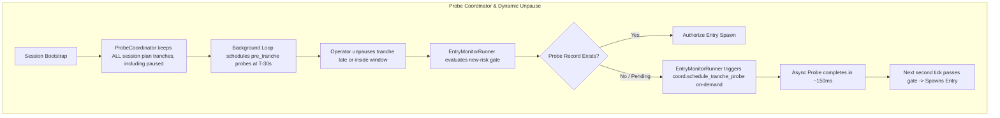

# Design & Implementation: MEIC Tranche Probe Unpause Gating Fix & Dashboard PermaBull High-Contrast

**Date:** 2026-08-21  
**Category:** Incident Resolution, Reliability Hardening & UI/UX  
**Components:** `common/probe_coordinator.py`, `blocks/entry/runner.py`, `dashboard/templates/index.html`, `tests/test_probe_coordinator.py`  
**Status:** Implemented & Verified with Unit Tests

---

## 1. Problem Statements & Root Cause Analysis

### Issue A: MEIC 10:45 Tranche Blocked from Entering
- **Symptom**: On 2026-08-21 at 10:44 CT, the launcher prepared the SPX chain snapshot for lot `10-45`, but repeatedly logged:
  `New-risk REST gate blocked entry spawn: rest_probe_missing — no pre_tranche probe record for 10-45`
  Both `10-45_P` and `10-45_C` remained in `pending` status without entering.
- **Root Cause**:
  1. In `run.py`, `ProbeCoordinator` was initially started with `MEIC_TRANCHE_SLOTS`.
  2. Moments later at line 516, `eligible = meic_tranches_from_session_plan(plan)` was called. Because `10-45` and `11-15` are paused by default in the morning session CSV, `eligible` only contained `[11-45, 12-15, 12-45, 01-30]`.
  3. `coord.set_tranches(eligible)` stripped `10-45` from the probe coordinator's internal schedule.
  4. When the operator unpaused `10-45` on the dashboard, `coord.set_tranches` was never updated.
  5. As a result, `ProbeCoordinator` never ran the 30s pre-tranche REST probe for `10-45` at 10:43:30.
  6. When the entry window opened at 10:44:00, `EntryMonitorRunner` checked the gate and found no probe record on file. Unlike manual trades (which had on-demand fallback), MEIC lacked automatic on-demand probe triggering, leaving `10-45` permanently blocked.

### Issue B: Low Contrast on PermaBull Tab & Panel
- **Symptom**: The PermaBull PCS dashboard text, status labels, configuration summaries, and table cells were faint and difficult to read against the dark theme background.
- **Root Cause**:
  - The PermaBull panel lacked dedicated dark-theme styling, defaulting to low-contrast Bootstrap `.text-muted` (`#64748b`), standard Bootstrap alert colors, and generic tables without alternating row contrast.

---

## 2. Technical Architecture & Flow



---

## 3. Implementations

### A. Dynamic Probe Scheduling & Fallback (`common/probe_coordinator.py` & `blocks/entry/runner.py`)
1. **On-Demand Tranche Probe Dispatch**:
   - Added `ProbeCoordinator.schedule_tranche_probe(strategy, tranche_id, source='pre_tranche')` to asynchronously execute and record a probe for any tranche on-demand if not already started.
2. **Include Paused Slots in Coordinator Schedule**:
   - Updated `meic_tranches_from_session_plan(plan, include_paused=True)` so that all pending slots in the session plan are registered with the coordinator. Probes run at $T-30\text{s}$ so unpausing never encounters a missing probe.
3. **Automated On-Demand Trigger in Entry Monitor**:
   - In `EntryMonitorRunner._gate_allows_spawn()`, when `decision.reason in ('rest_probe_pending', 'rest_probe_missing')` occurs for a scheduled MEIC tranche, calls `self._ensure_tranche_probe(tranche_id=tranche_id, strategy=strategy)` to immediately initiate the probe rather than permanently stalling.

### B. High-Contrast Dashboard Styling (`dashboard/templates/index.html`)
1. **Dedicated Perma Bull Panel Styles**:
   - Styled `#strategy-perma-bull .alert-info` with `#1e293b` background, `#38bdf8` accent border, and bright `#f1f5f9` text.
   - Set status titles to `#94a3b8` font-weight 700, status values to `#f8fafc` 1.1rem, and config text to `#cbd5e1`.
2. **Alternating High-Contrast Tables**:
   - Introduced `.perma-bull-table` with `#181c28` headers, `#1a1e2b` / `#202536` alternating row backgrounds, `#f1f5f9` cell text, and vibrant status badges (`bg-success`, `bg-secondary`, `bg-primary`).

---

## 4. Verification & Unit Tests

```bash
uv run pytest tests/test_probe_coordinator.py tests/test_entry_runner.py -q
# 15 passed in 8.85s
```

### Verified Test Cases:
- `test_schedule_tranche_probe_on_demand`: PASSED (verifies on-demand probe execution for late-unpaused tranches).
- `test_meic_tranches_from_session_plan_includes_paused_by_default`: PASSED (verifies paused slots are kept in the coordinator list).
- `test_one_startup_and_one_per_tranche_budget`: PASSED.
- `test_missed_exactly_once`: PASSED.
