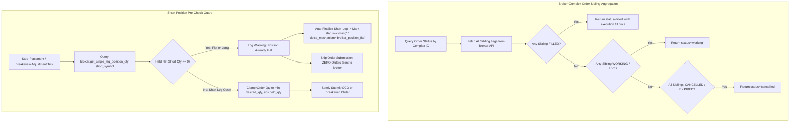

# Design & Implementation: MEIC OCO Sibling Order Resolution, Ghost BTO Prevention & Position Pre-Checks

**Date:** 2026-09-02  
**Category:** Incident Fix & Hardening  
**Components:** `brokers/tastytrade_broker.py`, `blocks/stop/monitor.py`, `tests/test_meic_oco_and_breakeven.py`  
**Status:** Implemented & Verified with Unit Tests

---

## 1. Executive Summary & Problem Statements

Following the transition from single exchange stop-market orders to bracketed One-Cancels-Other (OCO) orders (combining a 15¢ Profit Target and an Initial Stop Loss), two critical failure modes were discovered in live trading:

1. **Sibling Order State Misinterpretation (The OCO Churn Loop)**:
   - When placing an OCO order via TastyTrade, the broker generates a `complex_order` containing two child sibling legs:
     - Leg 1: Profit Target Limit (`BUY_TO_CLOSE` @ $0.15).
     - Leg 2: Stop Loss Market / Stop Limit (`BUY_TO_CLOSE` @ Stop Price).
   - When the profit target hit and filled, TastyTrade automatically cancelled the remaining stop loss sibling leg.
   - However, when `get_order_status()` queried `live_orders` by `complex_order_id`, it inspected only the first matching record in the response. If the cancelled sibling leg appeared first, `get_order_status()` reported `status = 'cancelled'`.
   - The stop monitor interpreted this cancellation as an unfulfilled order, believing the position was unprotected, and continuously re-submitted new OCO orders.

2. **Ghost Leg Creation & Margin Exhaustion (5×–6× Unintended BTOs)**:
   - Because the short leg had already been closed by the first fill, subsequent re-submitted buy orders were treated as opening orders (`BUY_TO_OPEN`) by the exchange.
   - The account accumulated 5× to 6× unwanted long debit legs, wasting commission and transaction costs.
   - Eventually, broker margin checks triggered `margin_check_failed` errors due to exhausted buying power, spamming API requests and choking execution.

---

## 2. Technical Design & Architecture



---

## 3. Detailed Implementations

### A. TastyTrade Complex Order Sibling Aggregation (`brokers/tastytrade_broker.py`)
- **File**: `brokers/tastytrade_broker.py`
- **Logic**:
  - In `get_order_status()`, when matching by `complex_order_id`, the method no longer returns immediately on the first matching child.
  - It collects all matching sibling records for that `complex_order_id`.
  - **Aggregation Hierarchy**:
    1. If **any** sibling has `status == 'filled'`: returns `status = 'filled'` along with the executed fill price and filled quantity.
    2. If **any** sibling has `status in ('working', 'live', 'in_flight')`: returns `status = 'working'`.
    3. If **all** siblings are `cancelled`, `rejected`, or `expired`: returns `status = 'cancelled'`.
- **Result**: Cancelling one leg of an OCO upon profit target fill immediately reports the overall complex order as `filled`, completely ending the order cycle.

### B. Short Leg Position Pre-Checks in Stop Monitor (`blocks/stop/monitor.py`)
- **File**: `blocks/stop/monitor.py`
- **Logic**:
  1. **`_place_short_stop()`**:
     - Before submitting any stop or OCO order, queries:
       ```python
       held_qty = self.broker.get_single_leg_position_qty(short_sym)
       ```
     - If `held_qty >= 0` (flat or accidentally long):
       - Emits log: `position for {short_sym} is already flat/long (qty={held_qty}) — auto-finalizing short leg`.
       - Transitions state: `state.short_leg.status = 'closing'`, `state.status = 'closing'`, `state.close_mechanism = 'broker_position_flat'`.
       - Returns `None`, sending **0 orders** to the broker.
     - Clamps order quantity: `order_qty = min(desired_qty, abs(held_qty))`.
  2. **`adjust_stop_to_breakeven()`**:
     - Added the identical `held_qty >= 0` pre-check prior to cancelling or replacing working stops during companion breaches.
     - If the short leg is already closed, breakeven adjustment aborts safely without issuing replacement buy orders.
  3. **Fast Stop Sync for OCO Orders (`_sync_working_stop_order()`)**:
     - Extended order type recognition to include `'OCO'` alongside `'STOP_LIMIT'` and `'LIMIT'`, ensuring OCO status is synchronized continuously during fast polling.

---

## 4. Files Modified

| File | Primary Changes |
|---|---|
| `brokers/tastytrade_broker.py` | Sibling order aggregation across complex child orders for accurate fill reporting. |
| `blocks/stop/monitor.py` | Position pre-checks in `_place_short_stop()` and `adjust_stop_to_breakeven()`; quantity clamping; OCO fast sync. |
| `tests/test_meic_oco_and_breakeven.py` | Comprehensive test suite covering sibling aggregation, flat position skips, and OCO sync. |

---

## 5. Automated Verification & Test Results

The implementation was validated using unit tests mocking broker positions and complex order responses:

```bash
.venv\Scripts\python -m unittest tests/test_meic_oco_and_breakeven.py
```

### Test Cases Passed:
- `test_get_order_status_complex_order_sibling_aggregation`: Validates sibling order aggregation where cancelled sibling does not mask the filled profit target leg.
- `test_place_short_stop_skips_when_flat_and_moves_to_closing`: Validates that 0 orders are placed when position is flat, setting status to `closing`.
- `test_adjust_stop_to_breakeven_skips_when_flat`: Validates that companion breach does not place buy orders if short position is flat.
- `test_sync_working_stop_order_includes_oco`: Validates fast sync handling for OCO order types.
- `test_place_short_stop_clamps_to_held_quantity`: Confirms stop size never exceeds net held contracts.

**Result:** `Ran 12 tests in 0.200s — OK` (All 12 tests passed).
