# Design & Implementation: MEIC Companion Breach Safety, Dynamic Spread Width Expansion & Dashboard Phase Tooltip

**Date:** 2026-09-03  
**Category:** Incident Fix & Enhancement  
**Components:** `blocks/stop/companion_breach.py`, `blocks/entry/meic_worker.py`, `common/strike_guard.py`, `blocks/entry/spread_scan.py`, `dashboard/server.py`, `dashboard/templates/index.html`  
**Status:** Implemented & Verified with Unit Tests

---

## 1. Executive Summary & Problem Statements

During the live session on **2026-09-03**, multiple operational and observational issues were identified:

1. **1:30 CCS Premature Stop via False Companion Breach**:
   - At the 1:30 PM CT tranche, the Call Credit Spread (`01-30_C`) was entered and filled. However, the companion Put Credit Spread (`01-30_P`) failed or was cancelled prior to fill due to market conditions.
   - When the stop monitor evaluated `01-30_C`, `is_companion_breached()` evaluated the unentered/failed companion trade state (or cross-matched an archived trade state from a past session date, e.g. August 24).
   - Because fill quantities were not strictly enforced and date matching was unconstrained, the companion was falsely deemed "breached".
   - This caused `01-30_C` to prematurely tighten its stop to breakeven (Phase `Short Stop 1×` / `Breakeven`), leading to an unnecessary premature stop-out.

2. **Strike Collision Trap & Missed Spread Entries**:
   - When scanning for spreads (e.g. at 25 width), if a long leg collided with an active trade's leg, the scanner only attempted $5 strike shifts.
   - If shifting pushed credit outside the acceptable credit boundaries, the candidate was abandoned.
   - The scanner did not attempt to expand spread width from 25 to 30 or 35 to resolve the collision while preserving the optimal short strike.

3. **Dashboard Phase Ambiguity & Lack of Stop History Observability**:
   - The dashboard Phase column displayed ambiguous states like `Phase 1 (1×)` even after trades had closed.
   - Operators could not distinguish whether a closed spread exited via 15¢ Profit Target, Stop Loss, Expiry Settlement, or Software Breach.
   - There was no in-place mechanism to inspect the historical progression of stop prices and adjustments over time without manually opening raw trade JSON files.

---

## 2. Technical Design & Architecture

```mermaid
flowchart TD
    subgraph Companion_Breach_Safety[Companion Breach Date Scoping & Fill Validation]
        A[Evaluate Active Trade] --> B[find_companion_trade_state with session_date filter]
        B --> C{Companion found on TODAY'S date?}
        C -- No / Past Date --> D[Return None -> NO Breach]
        C -- Yes --> E{filled_quantity > 0 & fill_price > 0?}
        E -- No: pending/failed/cancelled --> F[Return False -> Unentered Side NEVER Breached]
        E -- Yes: Active short leg held --> G[Evaluate Price vs Stop Multiplier]
        G --> H{Short Leg Breached?}
        H -- Yes --> I[Trigger Companion Breakeven Tightening]
        H -- No --> J[Keep Standard Stop Monitoring]
    end

    subgraph Dynamic_Width_Expansion[Collision Resolution via Width Expansion]
        K[Spread Candidate Selected] --> L{Leg Overlap Conflict Detected?}
        L -- No --> M[Return Candidate]
        L -- Yes --> N{Can Expand Width? curr_w < spread_width_max}
        N -- Yes --> O[Test Width +5: 25 -> 30 -> 35 keeping Short Strike]
        O --> P{No Overlap & In Credit Band?}
        P -- Yes --> Q[Return Expanded Width Candidate]
        P -- No --> N
        N -- No --> R[Fall back to Strike Shifting ATM / OTM]
    end

    subgraph Dashboard_Observability[Phase Label Enrichment & Hover Tooltip]
        S[Trade State] --> T{Status == 'closed'?}
        T -- Yes --> U[Format Terminal Label: Closed PT 15¢, Closed Stop, Settled Expiry]
        T -- No --> V[Format Active Label: Breakeven 1x, Phase 1 2x, etc.]
        U --> W[Compile stop_history into chronological timestamped lines]
        V --> W
        W --> X[Inject into title tooltip on Phase cell with dotted underline cursor: help]
    end
```



---

## 3. Detailed Implementations

### A. Companion Breach Protection & Date Scoping (`blocks/stop/companion_breach.py`)
- **Strict Date Isolation**: Updated `find_companion_trade_state()` to extract the current trade's date via `_extract_trade_date(trade_state)` and strictly require that any matching companion file in `trades/active/` or `trades/archive/` shares the exact same date prefix (`YYYY-MM-DD`). Files from previous dates (e.g. August 24) are completely ignored.
- **Fill Enforcement**: In `is_companion_breached()`, added:
  ```python
  if comp_status in ('pending_fill', 'failed', 'cancelled'):
      return False
  if companion.get('filled_quantity', 0) <= 0:
      return False
  ```
  A companion trade that never filled its short leg cannot trigger a breach on the surviving side.

### B. Ghost Trade Cleanup & Strike Guard Defense
- **File**: `blocks/entry/meic_worker.py`
  - When an entry order fails or is cancelled without fills, the trade state is cleanly transitioned to `'cancelled'` instead of lingering as `'pending_fill'` in `trades/active/`.
- **File**: `common/strike_guard.py`
  - In `leg_overlap_conflict()`, trades in `pending_fill` whose broker order is cancelled, rejected, or has 0 fills are ignored so they do not block subsequent tranche entries.

### C. Dynamic Spread Width Expansion (`blocks/entry/spread_scan.py`)
- **Width Expansion on Collision**:
  - In `_resolve_overlap_candidate()`, before falling back to strike shifting, the scanner iterates width expansion:
    ```python
    curr_width = abs(candidate.short_strike - candidate.long_strike)
    if curr_width < max_w:
        for target_w in range(curr_width + config.STEP, max_w + 1, config.STEP):
            # Test width expansion keeping candidate.short_strike...
    ```
  - If expanding width (e.g. 25 &rarr; 30 &rarr; 35) eliminates the collision and the credit remains within the expanded allowable band, the candidate is immediately accepted.
- **Initialization Scoping**:
  - Fixed `scan_credit_spreads()` so passing `spread_width=25` retains `wmax = spread_width_max or config.SPREAD_WIDTH_MAX` (35), giving the resolution engine the headroom to expand width on clashes.

### D. Dashboard Phase Enrichment & Hover Tooltip
- **File**: `dashboard/server.py`
  - Updated `_phase_display()` to return clear terminal labels:
    - `Closed (PT 15¢)` for `profit_target_oco`
    - `Closed (Stop)` for `exchange_stop`
    - `Settled (Expiry)` for `expiry_settlement`
    - `Closed (Breach)` for `software_breach`
    - `Breakeven (1×)` for tightened active stops
  - Added `_format_phase_tooltip(stop_history, current_label)` to generate chronological, timestamped progression logs:
    ```text
    Phase Progression:
    • 09:30:15: Stop Placed @ $2.50 (#12345) [initial_stop]
    • 10:15:30: Breakeven Tightened @ $0.85 (#12346) [breakeven_trigger]
    ```
  - Added `phase_tooltip` and `stop_history` to the slot payload dictionary.
- **File**: `dashboard/templates/index.html`
  - Updated the Phase cell to render `title="${s.phase_tooltip}"` with `style="cursor: help; text-decoration: underline dotted 1px;"`.

---

## 4. Files Modified

| File | Primary Changes |
|---|---|
| `blocks/stop/companion_breach.py` | Strict session date scoping and mandatory short fill check before allowing companion breach. |
| `blocks/entry/meic_worker.py` | State cleanup on failed entries, marking trades `'cancelled'`. |
| `common/strike_guard.py` | Ignored cancelled/rejected `pending_fill` trades during overlap conflict checks. |
| `blocks/entry/spread_scan.py` | Dynamic spread width expansion (25 &rarr; 30/35) on strike collisions; `wmax` initialization fix. |
| `dashboard/server.py` | Terminal phase badges, breakeven display, and `_format_phase_tooltip` generation. |
| `dashboard/templates/index.html` | Phase column tooltip rendering with dotted underline and hover cursor. |
| `tests/test_spread_scan_pick.py` | Unit test for dynamic width expansion resolving long-leg clashes. |
| `tests/test_dashboard_phase_display.py` | Unit tests for terminal phase badges and tooltip formatting. |

---

## 5. Automated Verification & Test Results

The full test suite covering stop monitoring, companion breach safety, dynamic width expansion, strike collision defense, and dashboard phase rendering was executed:

```powershell
.venv\Scripts\python -m unittest tests/test_meic_oco_and_breakeven.py tests/test_dashboard_phase_display.py tests/test_strike_guard.py tests/test_spread_scan_pick.py
```

### Output:
```text
Ran 35 tests in 0.723s

OK
```

All 35 unit tests passed with 0 failures and 0 errors.
