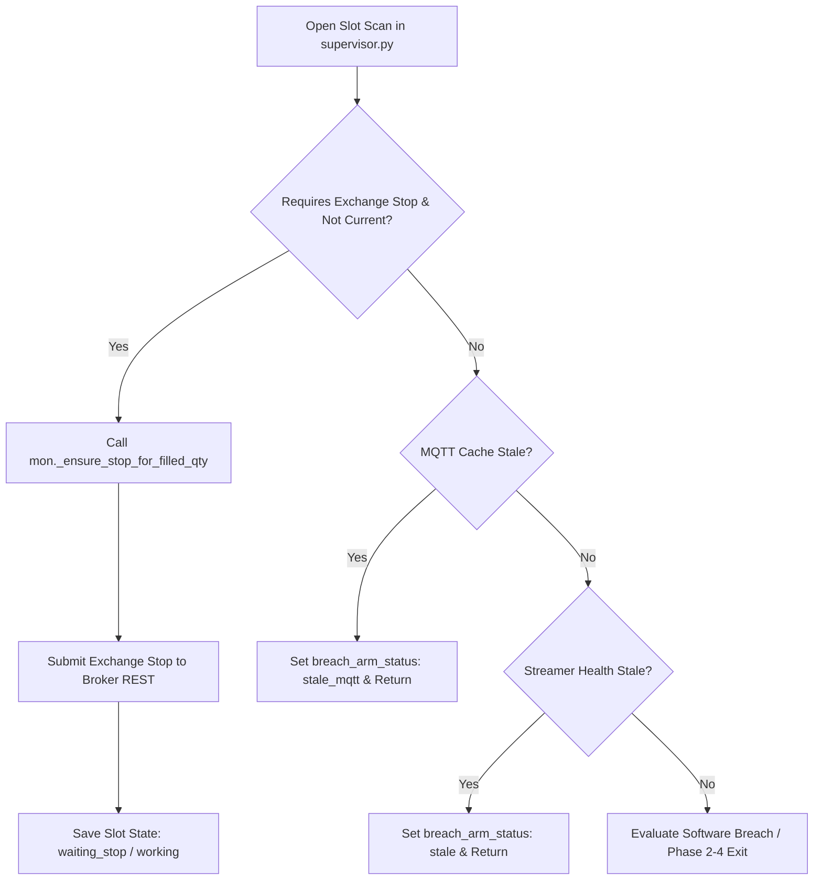

# Incident Resolution: Exchange Stop Placement Priority & Streamer Resilience

**Date**: 2026-09-09  
**Category**: Bug Fix & High-Availability Resilience  
**Affected Components**:
- `blocks/stop/v3/supervisor.py` (V3 Stop Supervisor)
- `streaming/publish_tastytrade.py` (DXLink TastyTrade Streamer)
- `tests/test_v3_exchange_stop.py` (Unit Tests)  
**Status**: Resolved & Verified in Live Trading  

---

## 1. Problem Statement & Root Cause

### Symptom
During live trading on 2026-09-09, after the initial `11-15_P` tranche filled and received its exchange stop (`#8224346`), the TastyTrade DXLink streamer process crashed at 11:39:35 CT.
Subsequently:
1. `11-45_C`, `11-45_P`, and `12-15_P` entered and filled at TastyTrade.
2. None of these three positions had exchange stop orders submitted to TastyTrade. The operator noted that only one PCS had active stops at the brokerage.
3. The dashboard SPX price display became frozen/stale because MQTT updates had halted.

### Root Cause
1. **Ordering Bug in `blocks/stop/v3/supervisor.py` (`_scan_open_slot`)**:
   Lines 652–667 contained early returns for `mqtt_cache_stale` and `streamer_stale`:
   ```python
   if mqtt_cache_stale:
       self._lifecycle_section(slot)['breach_arm_status'] = 'stale_mqtt'
       save_slot(slot)
       return

   if streamer_stale:
       self._lifecycle_section(slot)['breach_arm_status'] = 'stale'
       save_slot(slot)
       return

   if _requires_exchange_stop(slot.state) and not self._stop_is_current_for_slot(slot):
       mon._ensure_stop_for_filled_qty()
       ...
   ```
   When the streamer died at 11:39:35, `mqtt_cache_stale` evaluated to `True`. As a result, the supervisor returned immediately at line 655 on every 250ms tick, never reaching line 662 (`_ensure_stop_for_filled_qty()`).
   Placing an exchange stop via broker REST does *not* depend on live MQTT quotes (it uses entry fill prices and fixed multipliers). Blocking stop submission due to quote cache staleness left live broker positions unprotected against adverse market swings.

2. **Streamer Process Exit on Disconnect**:
   `streaming/publish_tastytrade.py` did not contain a reconnection loop around `asyncio.run(_stream_loop(session, slog))`. Any unhandled websocket disconnect or DXLink network drop caused `main()` to exit directly with status code 1.

---

## 2. Technical Architecture & Control Flow



Placing and maintaining the initial exchange stop is now prioritized **above** quote freshness checks. Quote freshness guards software breach logic and phase advancement, but never prevents placing the broker-side stop.

---

## 3. Detailed Implementation

### A. `blocks/stop/v3/supervisor.py`
Moved `_requires_exchange_stop` and `_ensure_stop_for_filled_qty()` before `mqtt_cache_stale` and `streamer_stale` checks:
```python
        if _requires_exchange_stop(slot.state) and not self._stop_is_current_for_slot(slot):
            mon._ensure_stop_for_filled_qty()
            slot.state = mon.state
            self._lifecycle_section(slot)['breach_arm_status'] = 'waiting_stop'
            save_slot(slot)
            return

        if mqtt_cache_stale:
            self._lifecycle_section(slot)['breach_arm_status'] = 'stale_mqtt'
            save_slot(slot)
            return

        if streamer_stale:
            self._lifecycle_section(slot)['breach_arm_status'] = 'stale'
            save_slot(slot)
            return
```

### B. `streaming/publish_tastytrade.py`
Wrapped the main streaming execution in an auto-reconnecting loop with exception logging so unexpected drops reconnect after 3 seconds:
```python
def main():
    slog = _get_logger()
    slog.info('TastyTrade streamer starting')
    while True:
        try:
            session = create_tastytrade_session()
            asyncio.run(_stream_loop(session, slog))
            slog.info('TastyTrade streamer stopped normally')
            break
        except (KeyboardInterrupt, SystemExit):
            slog.info('TastyTrade streamer shutdown requested')
            break
        except Exception as exc:
            slog.exception('Streamer loop encountered error, reconnecting in 3s: %s', exc)
            time.sleep(3)
    slog.info('TastyTrade streamer stopped')
```

---

## 4. Verification & Validation

### Live Verification
1. Streamer launched and streaming DXLink live quotes to MQTT (SPX ~$7645.71, `is_stale: False`, `trades/streamer_health.json` updated with `live` status).
2. Stop monitor immediately submitted the missing stop orders to TastyTrade:
   - **`11-15_P`**: Order `#8224346` @ `$3.20` (already working)
   - **`11-45_C`**: Order `#8247501` @ `$2.70` (OCO Stop Limit `$2.70`/`$2.80`, Profit `$0.15`)
   - **`11-45_P`**: Order `#8247503` @ `$2.70` (OCO Stop Limit `$2.70`/`$2.80`, Profit `$0.15`)
   - **`12-15_P`**: Order `#8247506` @ `$3.00` (OCO Stop Limit `$3.00`/`$3.10`, Profit `$0.15`)
   All active open trades now have confirmed broker stops in `working` status.

### Automated Tests
Added `TestV3ExchangeStopPriorityWhenStale` to `tests/test_v3_exchange_stop.py`:
- Command: `.venv/Scripts/pytest tests/test_v3_exchange_stop.py -v`
- Result: 3 passed in 2.75s
