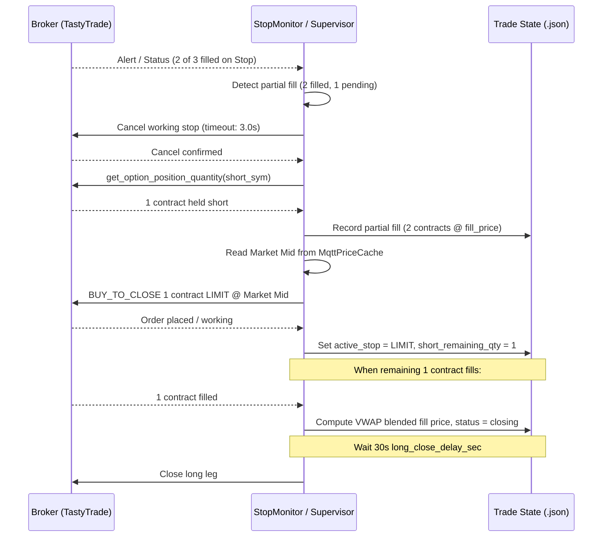

# Stop Order Partial Fill Immediate Cancellation & Market Mid Limit Replacement

- **Date**: 2026-10-20
- **Category**: Bug Fix & Execution Safeguard
- **Affected Components**:
  - [`blocks/stop/monitor.py`](file:///c:/Users/User/OneDrive/Desktop/Projects/2026/MEIC-with-Dash-main-V2/blocks/stop/monitor.py)
  - [`blocks/stop/fill_sync.py`](file:///c:/Users/User/OneDrive/Desktop/Projects/2026/MEIC-with-Dash-main-V2/blocks/stop/fill_sync.py)
  - [`blocks/stop/v3/supervisor.py`](file:///c:/Users/User/OneDrive/Desktop/Projects/2026/MEIC-with-Dash-main-V2/blocks/stop/v3/supervisor.py)
  - [`tests/test_partial_fill_stops.py`](file:///c:/Users/User/OneDrive/Desktop/Projects/2026/MEIC-with-Dash-main-V2/tests/test_partial_fill_stops.py)
- **Status**: Implemented & Verified with Automated Test Suite (11/11 Passed)

---

## 1. Problem Statement & Incident Context

During a fast market decline on 2026-10-20, manual credit spread trade `ms-453_P` holding 3 contracts hit its stop price:
- 2 of the 3 contracts filled on the broker's exchange stop book.
- 1 contract remained unfilled/pending as the market moved rapidly through the stop price.
- Software breach detection subsequently triggered, but failed to close the 1 remaining pending short contract.

### Root Causes
1. **Quantity Desynchronization on Breach Close**:
   `replace_with_limit_close()` in `blocks/stop/monitor.py` called `qty = stop_qty_for_state(self.state)`. Because `stop_qty_for_state()` originally returned `filled_quantity` (3), the system attempted to place a `BUY_TO_CLOSE` limit order for 3 contracts. Since TastyTrade only had 1 remaining short contract open, the broker rejected the order with:
   `cannot_close_more_than_existing_position: You cannot close more than 1.0 for SPXW 261020P07680000`.
2. **Infinite Resize Loop**:
   `_ensure_stop_for_filled_qty` saw `stop_quantity (1) != filled_quantity (3)` and endlessly attempted to resize the 1-contract stop order back up to 3.
3. **Partial Fills Treated as Working Stop**:
   `_reconcile_active_stop_with_broker` and `_drain_alert_fills` previously lacked active handling for `partially filled` status, leaving partially filled stops unaddressed until full fill or external cancellation.

---

## 2. Target Behavior Specification

1. **Immediate Cancellation**: As soon as a partial fill is detected on an active stop order (via WebSocket alert stream, REST status sync, or order update), immediately issue a cancellation to the broker for the working stop (waiting up to 3 seconds for confirmation).
2. **Audit Remaining Position**: Upon cancel confirmation, query the broker's actual position (`get_option_position_quantity()`) and record filled contracts and prices into `short_partial_fills`.
3. **Immediate Market Mid Limit Order**:
   - If remaining short contracts > 0, place a `BUY_TO_CLOSE` limit order at current **Market Mid** (`get_market_mid()`) for the remaining quantity immediately with **no wait time**.
   - If all short contracts filled (e.g. during cancellation race), transition immediately to `closing`.
4. **Deferred Long Leg Close**: Once all short strikes are closed completely, wait the configured delay (30 seconds via `long_close_delay_sec`) before executing the long leg close.
5. **Shared Architecture**: Shared across both automated MEIC strategies and manual discretionary trades (`StopSupervisor` and `StopMonitor`).

---

## 3. Architecture & State Flow



---

## 4. Implementation Details

### A. `blocks/stop/fill_sync.py`
Updated `stop_qty_for_state(state)`:
- Returns `short_remaining_qty` if explicitly set.
- Calculates remaining quantity by subtracting the sum of contracts recorded in `short_partial_fills` from total initial filled quantity.

### B. `blocks/stop/monitor.py`
1. **`_calculate_blended_short_close_price(final_price, final_qty)`**:
   Computes volume-weighted average price (VWAP) across historical partial fills and the final fill to ensure accurate P&L calculation.
2. **`handle_partial_stop_fill(active, broker_result)`**:
   - Cancels working stop order with up to 3.0s confirmation.
   - Audits actual remaining short position via `broker.get_option_position_quantity()`.
   - Records partial fill into `state['short_partial_fills']` and logs audit trail.
   - If remaining short position is 0, records blended fill price and marks status `closing`.
   - If remaining > 0, reads live market mid (`prices.get_market_mid()`), rounds to valid SPX option tick, and immediately places `BUY_TO_CLOSE` limit order for the remaining quantity.
3. **`replace_with_limit_close()`**:
   - Clamps replacement order quantity to broker's actual held short position (`min(qty, remaining_short)`).
   - If broker short position is already flat (`<= 0`), transitions directly to `closing` and avoids placement failure.
4. **`_sync_active_close_order()` & `_reconcile_active_stop_with_broker()`**:
   - Intercepts partial fill status and routes immediately to `handle_partial_stop_fill()`.

### C. `blocks/stop/v3/supervisor.py`
Updated `_drain_alert_fills()`:
- When a WebSocket alert arrives with a partial fill status or partial fill count, routes immediately to `mon.handle_partial_stop_fill()`.

---

## 5. Verification & Test Coverage

All 11 tests in [`tests/test_partial_fill_stops.py`](file:///c:/Users/User/OneDrive/Desktop/Projects/2026/MEIC-with-Dash-main-V2/tests/test_partial_fill_stops.py) pass cleanly:

```bash
uv run pytest tests/test_partial_fill_stops.py -v
```

### Verified Test Cases:
1. `test_apply_stop_snapshot_does_not_set_fully_filled_on_partial`: Partial fill does not prematurely mark open order fully filled.
2. `test_blended_short_close_price`: Verifies VWAP price calculation across partial fills (e.g., 2 @ 2.75 + 1 @ 2.80 = 2.7667).
3. `test_handle_partial_stop_fill_all_filled_during_cancel`: Handles race condition where all remaining contracts fill before cancel arrives.
4. `test_handle_partial_stop_fill_cancels_and_replaces_with_mid_limit`: Cancels working stop and replaces remaining 1 contract with limit order at market mid.
5. `test_is_fill_sync_terminal_keeps_working_partial_fills_active`: Fill sync keeps polling while open orders are partially filled.
6. `test_merge_policy_adopts_filled_quantity_and_open_order`: Trade state merge respects partial fill counts.
7. `test_replace_with_limit_close_clamps_to_remaining_broker_position`: Prevents `cannot_close_more_than_existing_position` by clamping order quantity to broker short position.
8. `test_stop_qty_for_state_accounts_for_partial_fills`: Deducts closed contracts in `short_partial_fills`.
9. `test_stop_quantity_and_resize_on_partial_fill`: Prevents infinite resize loop on partially filled stops.
10. `test_sync_active_close_order_triggers_partial_fill_handling`: Reconcile poll immediately triggers partial fill handler.
11. `test_v3_supervisor_slot_eligible_on_partial_fill`: Partial fills remain active and managed by `StopSupervisor`.
